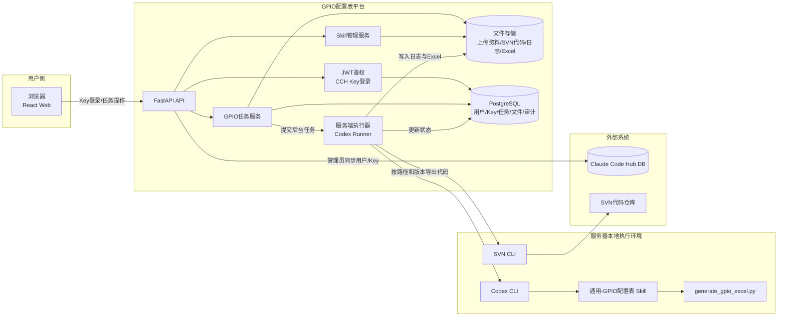
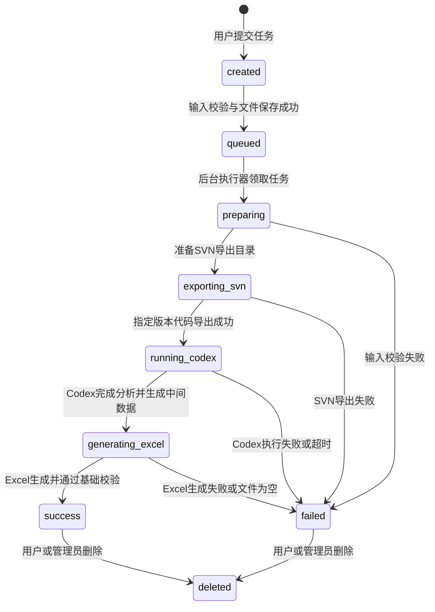
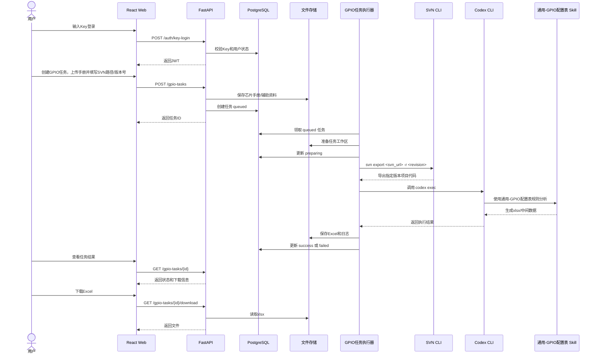
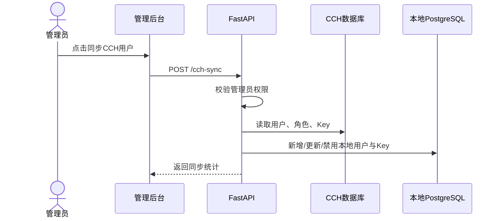
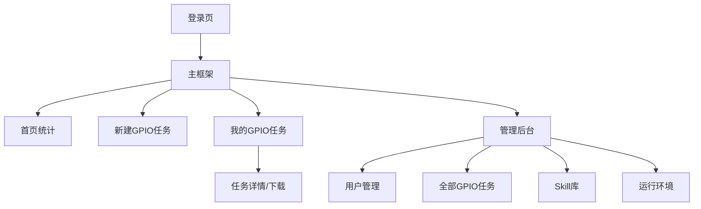

# 通用-GPIO配置表平台设计方案

> 版本：v0.1  
> 日期：2026-06-22  
> 目标形态：基于现有代码审查平台代码框架，沿用 CCH 账户与 Key 管理，部署为本地通用 GPIO 配置表生成平台。

## 1. 背景与目标

现有代码审查平台已经具备 React + FastAPI 前后端框架、CCH 用户同步、Key 登录、用户/管理员权限、任务管理、Skill 包管理和文件下载能力。通用-GPIO配置表平台希望复用这套框架，降低重复建设成本，并为后续接入更大的统一平台保留一致的账户、权限、任务、审计和部署模型。

平台的核心业务是：用户登录后上传芯片手册和可选辅助资料，输入项目代码的 SVN 路径与版本号，由服务器按版本拉取代码，再统一调用 Codex 与 `通用-GPIO配置表` Skill 生成 `.xlsx` GPIO 配置表。普通用户只能查看和下载自己的任务结果，管理员可以查看全部任务、管理用户、管理 Skill 和查看执行状态。

## 2. 设计原则

1. 复用现有框架，不重造账户体系、权限模型和基础 UI。
2. 服务端统一执行 Codex，用户侧只需要浏览器，不需要本机安装 Codex。
3. 输入资料和输出 Excel 全部归档，任务状态可追踪。
4. Skill 规则保持独立，平台只负责任务编排、文件管理、状态管理和结果交付。
5. 与后续大平台对接时，保留 CCH Key、用户角色、任务接口、审计日志等统一边界。

## 3. 范围定义

### 3.1 第一版包含

| 模块 | 内容 |
| --- | --- |
| 登录认证 | 沿用 CCH 用户同步与 Key 登录 |
| 用户权限 | 普通用户、管理员两类角色，沿用现有权限判断方式 |
| GPIO 任务 | 创建任务、上传芯片手册和辅助资料、填写 SVN 路径与版本号、查看状态、下载 Excel、删除任务 |
| 服务端执行 | 后端任务执行器调用 Codex CLI 与 `通用-GPIO配置表` Skill |
| SVN 代码获取 | 服务端按 SVN 路径和版本号导出项目代码，供 Codex 全项目识别 |
| 文件归档 | 保存芯片手册、辅助资料、SVN 导出代码、生成日志、Excel 结果 |
| 管理端 | 查看全部任务、筛选用户/状态/项目号、管理 Skill 包 |
| 本地部署 | 后端部署在本地服务器，前端 API 指向本地后端地址 |

### 3.2 第一版不包含

| 不包含内容 | 原因 |
| --- | --- |
| 在线编辑 Excel | 第一版聚焦自动生成和下载 |
| 多人协同批注 | 可作为后续大平台能力 |
| 复杂审批流 | 当前需求是内部工具生成平台 |
| 前端直接解析芯片手册 | 解析和推理交给 Codex + Skill |
| Electron 客户端执行 | 本需求明确为服务器统一执行 |

## 4. 总体架构



说明：

- React Web 复用现有前端布局、登录页、侧边栏、任务列表、管理员页面组件模式。
- FastAPI 复用现有认证、用户、CCH 同步、权限依赖、数据库迁移、Docker Compose 结构。
- GPIO 任务作为新业务模型，不直接复用 `ReviewTask` 字段，避免代码审查语义污染 GPIO 平台。
- 服务端执行器在服务器本地运行 SVN CLI 与 Codex CLI，不要求用户本地安装 SVN 或 Codex。

## 5. 用户与权限设计

### 5.1 账户来源

沿用代码审查平台的 CCH 同步逻辑：

1. 管理员在后台触发“同步 CCH 用户”。
2. 后端通过 `CCH_DATABASE_URL` 读取 CCH 用户、角色和 Key。
3. 本地数据库保存用户、角色、Key 启用状态。
4. 用户通过 Key 登录平台。

### 5.2 权限规则

| 角色 | 权限 |
| --- | --- |
| 普通用户 | 创建 GPIO 任务；查看自己的任务；下载自己的 Excel；删除自己的任务 |
| 管理员 | 同步 CCH 用户；查看全部任务；筛选任务；管理用户启停；管理 Skill；下载全部任务结果 |

SVN 仓库权限沿用代码审查平台的仓库前缀授权模型。普通用户创建 GPIO 任务时，后端必须校验 `svn_url` 是否落在该用户被授权的产品仓库或公共仓库前缀下；管理员可以提交任意已配置仓库路径。SVN 账号密码仍由服务端加密保存，避免用户在每次任务中重复输入。

### 5.3 鉴权边界

所有 GPIO 任务接口都必须依赖当前登录用户：

- 查询列表时，普通用户自动加 `user_id == current_user.id` 过滤。
- 获取详情、下载文件、删除任务时，普通用户只能操作自己的任务。
- 管理员可以跨用户访问。

## 6. 功能设计

### 6.1 用户端页面

| 页面 | 功能 |
| --- | --- |
| 登录页 | 输入 CCH Key 登录 |
| 首页统计 | 显示我的任务总数、运行中、成功、失败 |
| 新建 GPIO 任务 | 填写项目号、芯片型号、封装、SVN 路径、版本号、备注；上传芯片手册和可选辅助资料 |
| GPIO 任务列表 | 查看任务状态、创建时间、完成时间、错误原因、下载入口 |
| 任务详情 | 查看输入资料、执行日志摘要、生成结果、失败原因 |

### 6.2 管理端页面

| 页面 | 功能 |
| --- | --- |
| 用户管理 | 同步 CCH 用户、启停用户、查看角色 |
| GPIO 任务管理 | 查看全部任务，按用户、项目号、芯片型号、状态、日期筛选 |
| Skill 管理 | 上传/激活 `通用-GPIO配置表` Skill 包 |
| 环境状态 | 检查服务器 Codex CLI、Python、Skill 路径、输出目录是否可用 |

## 7. 输入输出设计

### 7.1 新建任务输入

| 字段 | 必填 | 说明 |
| --- | --- | --- |
| 项目号 | 是 | Excel 标题中的 `{项目号}`，例如 `SST22-1939-REV6.0` |
| 芯片型号 | 是 | Excel 标题中的 `{芯片号}`，优先完整封装/订货型号 |
| 封装 | 建议填 | 例如 `LQFP100`，用于从手册多封装表中定位目标列 |
| 芯片手册 | 是 | PDF/DOCX/图片/压缩包均可，第一版建议优先支持 PDF/DOCX/ZIP |
| SVN 路径 | 是 | 项目代码仓库或子目录 URL，沿用代码审查平台的 SVN 输入方式 |
| SVN 版本号 | 是 | 代码版本号，支持纯数字或 `r数字`，服务端规范化为 `r123` 形式 |
| 辅助资料 | 可选 | 原理图备注、已有资源表、BOM、管脚截图等 |
| 备注 | 可选 | 用户补充说明，例如重点关注的 MCU 或代码路径 |

### 7.2 输出结果

| 输出 | 说明 |
| --- | --- |
| GPIO 配置表 `.xlsx` | 主交付物 |
| 执行日志 `.log` | 记录 Codex 执行状态、错误摘要 |
| 中间结果目录 | 保存 Codex 分析产物、JSON/CSV 行数据、临时文件 |

Excel 必须符合 `通用-GPIO配置表` Skill 约束：

- Sheet `GPIO配置表`。
- Row 1 合并标题：`{项目号}-MCU资源分配（{芯片号}）`。
- Row 2 表头：`引脚编号`、`引脚名称`、`使用引脚定义`、`IO模式`、`说明`。
- 增加 Sheet `MCU外设触发关系`。
- 物理引脚编号和引脚名称以芯片手册正式管脚定义表为准。
- IO 模式、默认状态、有效电平、触发边沿和后续动作用全项目代码交叉验证。

## 8. 任务状态流转



状态建议：

| 状态 | 含义 |
| --- | --- |
| `created` | 任务记录已创建 |
| `queued` | 等待后台执行 |
| `preparing` | 正在准备工作区 |
| `exporting_svn` | 正在按 SVN 路径和版本号导出代码 |
| `running_codex` | 正在调用 Codex + Skill 分析 |
| `generating_excel` | 正在生成或校验 Excel |
| `success` | 成功，可下载 |
| `failed` | 失败，可查看错误原因 |
| `cancelled` | 后续可扩展，第一版可不开放取消按钮 |

## 9. 核心业务流程

### 9.1 用户生成流程



### 9.2 管理员同步 CCH 用户流程



## 10. 后端设计

### 10.1 目录建议

在现有 `backend/app` 内新增或替换业务模块：

```text
backend/app/
├── api/routes/gpio_tasks.py
├── services/gpio_task_service.py
├── services/gpio_runner.py
├── services/gpio_storage_service.py
├── models.py
└── alembic/versions/<revision>_add_gpio_tasks.py
```

### 10.2 数据模型建议

新增 `GpioTask`：

| 字段 | 类型 | 说明 |
| --- | --- | --- |
| `id` | UUID | 主键 |
| `user_id` | UUID | 创建用户 |
| `project_no` | str | 项目号 |
| `chip_model` | str | 芯片型号 |
| `package_name` | str/null | 封装 |
| `status` | enum | 任务状态 |
| `manual_file_path` | str | 芯片手册路径 |
| `svn_url` | str | 项目代码 SVN 路径 |
| `svn_revision` | str | SVN 版本号，统一保存为 `r数字` |
| `svn_export_path` | str/null | 服务端导出的指定版本代码目录 |
| `extra_file_path` | str/null | 辅助资料路径 |
| `workspace_path` | str | 任务工作区 |
| `excel_path` | str/null | 生成结果路径 |
| `excel_name` | str/null | 下载文件名 |
| `log_path` | str/null | 执行日志 |
| `error_message` | str/null | 失败原因 |
| `created_at` | datetime | 创建时间 |
| `started_at` | datetime/null | 开始时间 |
| `finished_at` | datetime/null | 完成时间 |
| `updated_at` | datetime | 更新时间 |

新增枚举 `GpioTaskStatus`：

```text
created, queued, preparing, exporting_svn, running_codex, generating_excel, success, failed, cancelled
```

### 10.3 API 设计

| 方法 | 路径 | 权限 | 说明 |
| --- | --- | --- | --- |
| `POST` | `/api/v1/gpio-tasks` | 登录用户 | 创建任务，上传手册/辅助资料并提交 SVN 路径与版本号 |
| `GET` | `/api/v1/gpio-tasks` | 登录用户 | 查询任务列表，管理员可查全部 |
| `GET` | `/api/v1/gpio-tasks/stats` | 登录用户 | 任务统计 |
| `GET` | `/api/v1/gpio-tasks/{id}` | 任务所有者/管理员 | 查看任务详情 |
| `DELETE` | `/api/v1/gpio-tasks/{id}` | 任务所有者/管理员 | 删除任务和文件 |
| `GET` | `/api/v1/gpio-tasks/{id}/download` | 任务所有者/管理员 | 下载 Excel |
| `GET` | `/api/v1/gpio-tasks/{id}/log` | 任务所有者/管理员 | 查看执行日志摘要 |
| `GET` | `/api/v1/gpio-runtime/health` | 管理员 | 检查 Codex/Python/Skill/目录可用性 |

### 10.4 执行器设计

执行器负责：

1. 扫描或领取 `queued` 任务。
2. 创建任务工作区。
3. 校验 SVN 路径和版本号，按指定版本导出项目代码。
4. 整理芯片手册、辅助资料和导出的代码目录。
5. 拼接 Codex 执行 Prompt。
6. 调用 `codex exec`。
7. 等待结果文件。
8. 校验 `.xlsx` 存在且非空。
9. 更新任务状态与错误信息。

建议第一版采用单进程后台线程或 FastAPI lifespan 启动的简单 worker；后续大平台并发需求增加时，再迁移到 Redis Queue/Celery/RQ。

Codex 调用策略：

```text
codex exec --dangerously-bypass-approvals-and-sandbox "<任务Prompt>"
```

任务 Prompt 必须明确：

- 使用 `通用-GPIO配置表` Skill。
- 芯片手册路径。
- SVN 路径与版本号。
- 服务端导出的项目代码目录。
- 项目号、芯片型号、封装。
- 输出 Excel 的绝对路径。
- 输出必须包含 `GPIO配置表` 和 `MCU外设触发关系`。
- 不确定项写入 `TODO[需人工确认]`，不得猜测。

## 11. 前端设计

### 11.1 信息架构



### 11.2 页面复用策略

| 现有代码审查平台页面/组件 | GPIO 平台复用方式 |
| --- | --- |
| 登录页 | 保留 Key 登录文案，替换平台名称 |
| 侧边栏 | 替换菜单为 GPIO 任务、任务统计、管理后台 |
| 任务统计组件 | 改为 GPIO 任务状态统计 |
| 任务列表组件 | 字段替换为项目号、芯片型号、封装、Excel 下载 |
| Skill 管理页 | 保留，文案改为 GPIO Skill 管理 |
| 用户管理页 | 保留 CCH 同步和启停用户能力 |

### 11.3 新建任务表单

表单布局建议：

1. 基本信息：项目号、芯片型号、封装。
2. 代码来源：SVN 路径、SVN 版本号。
3. 文件上传：芯片手册、辅助资料。
4. 生成说明：备注文本框。
5. 提交按钮：创建任务并进入任务详情页。

文件上传限制第一版建议：

| 文件 | 类型 | 大小建议 |
| --- | --- | --- |
| 芯片手册 | `.pdf`, `.docx`, `.zip` | 200 MB 内 |
| 辅助资料 | `.pdf`, `.docx`, `.xlsx`, `.png`, `.jpg`, `.zip` | 200 MB 内 |

## 12. 部署设计

### 12.1 本地部署目标

后端本地服务地址：

```text
http://172.23.17.242:8000
```

前端配置：

```env
VITE_API_URL=http://172.23.17.242:8000
```

### 12.2 关键环境变量

| 环境变量 | 说明 |
| --- | --- |
| `SECRET_KEY` | JWT 签名密钥 |
| `CCH_DATABASE_URL` | CCH PostgreSQL 连接串 |
| `SVN_CREDENTIAL_MASTER_KEY` | SVN 凭据加密主密钥，沿用代码审查平台加密方式 |
| `POSTGRES_SERVER` | 本地平台 PostgreSQL 地址 |
| `POSTGRES_PORT` | PostgreSQL 端口 |
| `POSTGRES_DB` | 平台数据库 |
| `POSTGRES_USER` | 数据库用户 |
| `POSTGRES_PASSWORD` | 数据库密码 |
| `GPIO_STORAGE_DIR` | GPIO 任务上传与输出根目录 |
| `SKILL_STORAGE_DIR` | Skill 包存储目录 |
| `GPIO_CODEX_TIMEOUT_SECONDS` | Codex 任务超时时间 |
| `GPIO_MAX_UPLOAD_BYTES` | 上传文件大小限制 |

### 12.3 服务器环境检查

管理员环境状态页和后端 `/gpio-runtime/health` 应检查：

| 检查项 | 命令/方式 |
| --- | --- |
| Codex CLI | `codex --version` |
| SVN CLI | `svn --version --quiet` |
| Python | `python --version` |
| GPIO Skill | 检查 Skill 目录或 active Skill 包 |
| Excel 脚本 | 检查 `generate_gpio_excel.py` 是否可用 |
| 存储目录 | 检查 `GPIO_STORAGE_DIR` 可写 |
| 数据库 | 调用健康检查 SQL |

## 13. 文件存储设计

建议结构：

```text
GPIO_STORAGE_DIR/
├── tasks/
│   └── <task_id>/
│       ├── uploads/
│       │   ├── manual.pdf
│       │   └── extra/
│       ├── workspace/
│       │   ├── svn-code/
│       │   └── codex-output/
│       ├── logs/
│       │   └── run.log
│       └── output/
│           └── <项目号>-MCU资源分配（<芯片型号>）.xlsx
└── tmp/
```

删除任务时，必须同时删除该任务目录，避免上传资料、SVN 导出代码和生成结果长期残留。

## 14. 安全与风险控制

| 风险 | 控制措施 |
| --- | --- |
| 用户越权下载他人结果 | API 层统一校验任务所有者或管理员 |
| SVN 路径越权或误填 | 沿用代码审查平台的 SVN 仓库前缀权限校验；普通用户只能提交被授权的仓库路径 |
| SVN 版本号非法 | 只允许纯数字或 `r数字`，服务端统一规范化 |
| SVN 导出失败 | 记录错误摘要，任务标记 failed，不进入 Codex 阶段 |
| Codex 长时间运行 | 设置任务超时，超时后标记 failed |
| 服务器并发过高 | 第一版限制单任务串行或小并发 |
| 上传资料泄露 | 文件按任务目录隔离，下载接口鉴权 |
| Excel 为空或格式错误 | 生成后做文件存在、大小、sheet 名基础校验 |
| CCH Key 失效 | 下次同步时禁用本地 Key，登录时拒绝 |

## 15. 错误处理

| 场景 | 用户提示 |
| --- | --- |
| 未上传芯片手册 | `请上传芯片手册。` |
| 未填写 SVN 路径 | `请填写项目代码 SVN 路径。` |
| 未填写 SVN 版本号 | `请填写 SVN 版本号。` |
| SVN 版本号格式错误 | `SVN 版本号格式不正确，请输入数字或 r数字。` |
| SVN 路径无权限 | `当前账号无权使用该 SVN 路径，请联系管理员配置仓库权限。` |
| SVN 导出失败 | `项目代码导出失败，请检查 SVN 路径、版本号或服务器 SVN 权限。` |
| Codex 不可用 | `服务器 Codex 环境不可用，请联系管理员。` |
| 未找到可靠管脚定义 | `没有找到可可靠对应的管脚定义表或封装引脚图，无法生成引脚编号和引脚名称。` |
| 生成超时 | `生成任务超时，请检查资料大小或联系管理员。` |
| 结果文件缺失 | `任务执行结束但未生成 Excel，请查看日志或联系管理员。` |

## 16. 测试方案

### 16.1 后端测试

| 测试项 | 验证点 |
| --- | --- |
| Key 登录 | 有效 Key 登录成功，无效/禁用 Key 返回 401 |
| 创建任务 | 手册上传、SVN 路径和版本号校验成功后生成任务记录和任务目录 |
| 权限隔离 | 普通用户不能读取、下载、删除他人任务 |
| 管理员访问 | 管理员可查看全部任务 |
| 状态流转 | queued 到 running_codex 到 success/failed |
| 下载结果 | 成功任务可下载 xlsx，失败任务不可下载 |
| SVN 校验 | 非法版本号、未授权 SVN 路径、导出失败能返回清晰错误 |
| 运行环境检查 | SVN/Codex/Python/Skill/目录状态返回正确 |

### 16.2 前端测试

| 测试项 | 验证点 |
| --- | --- |
| 登录页 | Key 登录成功后进入首页 |
| 新建任务页 | 项目号、芯片型号、SVN 路径、版本号、手册上传等必填校验正确 |
| 任务列表 | 状态展示、筛选、下载按钮状态 |
| 管理端 | 管理员可看到全部任务，普通用户不可进入 |
| 错误提示 | 上传失败、生成失败、下载失败提示清晰 |

### 16.3 集成冒烟

1. 管理员同步 CCH 用户。
2. 普通用户 Key 登录。
3. 创建 GPIO 任务，上传芯片手册并填写 SVN 路径和版本号。
4. 后台执行器导出指定版本代码。
5. 后台执行器调用 Codex。
6. 任务状态变为 success。
7. 用户下载 `.xlsx`。
8. 管理员在后台能看到该任务。

## 17. 迁移与对接策略

为了后续接入大平台，第一版应避免把 GPIO 平台做成一次性脚本页面，而是保留平台化边界：

- 账户继续来自 CCH。
- API 继续使用 `/api/v1` 前缀。
- 任务模型独立，字段清晰。
- Skill 管理保持可替换、可激活。
- 文件存储根目录通过环境变量配置。
- 前端路由和菜单采用模块化命名，例如 `/tasks/gpio`、`/admin/tasks/gpio`。

后续大平台可以通过以下方式对接：

| 对接方向 | 方式 |
| --- | --- |
| 统一登录 | 继续使用 CCH Key 或升级为统一 SSO |
| 统一任务中心 | 暴露 GPIO 任务 API 或统一任务模型 |
| 统一 Skill 管理 | 将 Skill 包管理抽象成平台公共模块 |
| 统一文件中心 | 将 `GPIO_STORAGE_DIR` 替换为对象存储 |
| 统一审计 | 将任务创建、下载、删除写入公共审计表 |

## 18. 推荐实施步骤

1. 复制现有 `code_review_server` 作为 GPIO 平台基础目录。
2. 替换项目名称、前端文案、菜单和环境变量。
3. 保留 CCH 同步、Key 登录、用户管理、Skill 管理。
4. 新增 `GpioTask` 数据模型和迁移。
5. 新增 `/gpio-tasks` 后端 API。
6. 新增服务端 SVN 导出与 GPIO 执行器。
7. 新增前端 GPIO 新建任务页、任务列表页、详情页。
8. 新增运行环境检查页。
9. 完成后端单元测试和前端基础测试。
10. 在本地服务器配置 `VITE_API_URL=http://172.23.17.242:8000` 并部署验证。

## 19. 待确认事项

| 事项 | 建议 |
| --- | --- |
| 新平台目录名 | 建议 `Agent/gpio_config_platform` |
| 是否保留 SVN 登录 | 登录仍使用 Key；SVN 凭据和仓库权限沿用代码审查平台的配置能力 |
| 是否保留代码审查相关页面 | 不保留，避免业务混淆 |
| Codex 并发数 | 第一版建议 1 个任务串行执行 |
| SVN 导出方式 | 第一版建议使用 `svn export` 导出指定版本代码到任务工作区 |
| 结果保留时间 | 第一版长期保留，后续加清理策略 |
