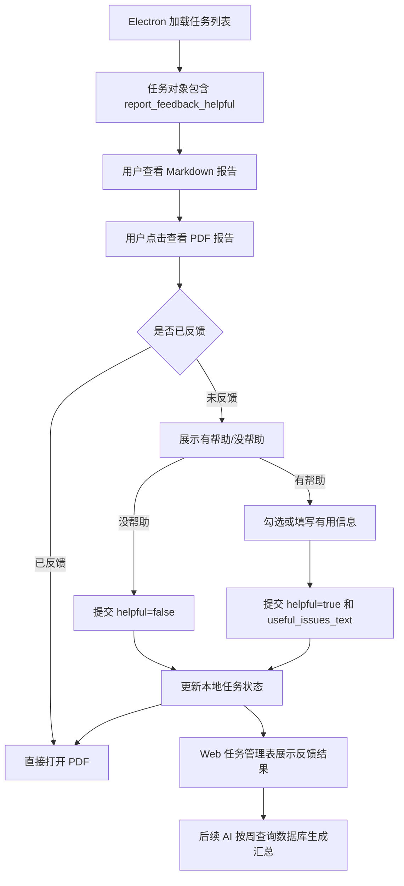

# 报告反馈闭环设计

## 背景

当前平台已有通用意见反馈功能，用于用户主动提交系统优化建议、Bug 反馈、使用问题等。这类反馈面向平台整体，不绑定某一份代码审查报告。

本次要新增的是“报告反馈闭环”。它面向 AI 生成的代码审查报告，必须绑定到具体审查任务和具体报告，用于统计报告内容是否真实有用，以及哪些报告内容值得保留、强化或作为后续审查优化方向。后续 AI 可以直接基于后端数据库按周整理报告反馈汇总，向领导说明报告功能的实用性和后续优化点。

因此，本功能不复用通用意见反馈表和通用意见提交接口。通用意见反馈仍保留给用户主动反馈不满、Bug 或平台优化建议；报告反馈只记录报告是否有帮助和有帮助时的具体有用信息。

## 已确认决策

- 打开 PDF 报告前必须先完成报告反馈。
- “没帮助”不要求填写原因，只记录结构化负反馈。
- 用户如果对报告不满、想反馈 Bug 或提出优化建议，仍使用通用意见反馈功能。
- “有帮助”时必须至少勾选或填写 1 条有用信息后才能提交并打开 PDF。
- 后端新增专用报告反馈表，不复用通用 `feedback` 表。
- 一份审查任务报告第一版只允许提交一次报告反馈。
- Web 管理端不新增独立报告反馈管理页面，直接在“代码审查任务管理”表格增加两个字段。
- 任务管理表新增 `是否有帮助` 和 `有用信息` 两列。
- `有用信息` 在表格内截断展示，鼠标悬浮后展示完整内容。
- 报告反馈权限范围跟任务管理一致：普通用户只看自己的任务，部门管理员看本部门任务，超级管理员看全部任务。
- 任务管理页需要优化大屏布局，避免左右空白很多但表格仍需要横向滚动。
- 文档、提交信息使用中文。

## 目标

1. 建立绑定代码审查任务的报告反馈数据源。
2. 让用户在打开 PDF 报告前完成轻量反馈闭环。
3. 结构化保存报告是否有帮助，以及有帮助时的有用信息。
4. 在 Web 任务管理页直接展示报告反馈结果，方便人工核对。
5. 为后续 AI 周报统计提供干净、可查询、可聚合的数据。
6. 避免报告反馈和通用意见反馈混用，保持业务边界清晰。
7. 优化任务管理页宽屏表格体验，提高大屏空间利用率。

## 非目标

第一版不做以下能力：

- 不新增独立的报告反馈管理菜单。
- 不做报告反馈处理状态、管理员回复、分派或闭环处理流程。
- 不要求“没帮助”填写原因。
- 不把报告反馈写入通用 `feedback` 表。
- 不支持同一任务多轮报告反馈。
- 不做复杂图表、导出文件或周报生成页面。
- 不在 Web 端实现报告反馈提交入口；第一版由 Electron 打开 PDF 前触发提交。
- 不要求用户对每一条报告问题做评分。

## 推荐方案

采用“专用报告反馈表 + 任务接口聚合展示”的方案。

后端新增 `review_task_report_feedback` 表，保存绑定任务的结构化反馈；新增专用接口 `POST /api/v1/review-tasks/{task_id}/report-feedback`。任务列表和任务详情接口在返回 `ReviewTaskPublic` 时附带两个展示字段：`report_feedback_helpful` 和 `report_feedback_useful_issues_text`。

Electron 打开 PDF 前检查当前任务是否已有报告反馈。如果已有，直接打开 PDF；如果没有，则显示报告反馈入口。用户点击“没帮助”后直接提交并打开 PDF；用户点击“有帮助”后必须勾选或填写至少一条有用信息，再提交并打开 PDF。

Web 端“代码审查任务管理”沿用原任务权限范围，在表格中增加 `是否有帮助` 和 `有用信息` 两列。后端仍单独维护报告反馈数据，Web 只做任务列表聚合展示。

该方案比把字段直接塞进 `review_task` 更清晰，也比复用通用 `feedback` 更利于统计和长期维护。

## 数据模型设计

新增表：`review_task_report_feedback`

表描述：代码审查报告反馈表，记录用户对具体审查任务报告是否有帮助以及报告中的有用信息。

字段设计：

| 字段名 | 类型 | 约束 | 中文描述 |
| --- | --- | --- | --- |
| `id` | UUID | 主键 | 报告反馈ID |
| `task_id` | UUID | 非空，外键到 `review_task.id`，唯一索引 | 代码审查任务ID |
| `user_id` | UUID | 非空，外键到 `user.id`，索引 | 提交人用户ID |
| `helpful` | Boolean | 非空，索引 | 报告是否有帮助 |
| `useful_issues_text` | Text/String | 可空，建议最大长度 4096 | 有帮助时记录的有用信息 |
| `created_at` | DateTime(timezone=True) | 非空，默认当前 UTC 时间，索引 | 提交时间 |
| `updated_at` | DateTime(timezone=True) | 非空，默认当前 UTC 时间 | 更新时间 |

索引建议：

- `ux_review_task_report_feedback_task_id`：`task_id` 唯一索引，确保一份任务报告只提交一次反馈。
- `ix_review_task_report_feedback_user_id`：按提交人查询。
- `ix_review_task_report_feedback_helpful_created_at`：支持按是否有帮助和时间统计。
- `ix_review_task_report_feedback_created_at`：支持周报按时间范围查询。

模型校验：

- `helpful=true` 时，`useful_issues_text` 去除空白后必须非空。
- `helpful=false` 时，`useful_issues_text` 可以为空；服务端可统一保存为空字符串或 `null`，接口返回时按空文本处理。
- `user_id` 来自当前登录用户，不接受前端传入。
- `task_id` 来自路径参数，不接受请求体覆盖。

## 后端 API 设计

### 提交报告反馈

```http
POST /api/v1/review-tasks/{task_id}/report-feedback
```

权限：

- 所有能读取该任务的登录用户可以提交该任务报告反馈。
- 普通用户只能提交自己任务的报告反馈。
- 部门管理员只能提交本部门任务的报告反馈。
- 超级管理员可以提交任意任务报告反馈。

请求体：

```json
{
  "helpful": true,
  "useful_issues_text": "1. 空指针风险\n2. 越界访问风险"
}
```

响应体建议返回创建后的报告反馈对象：

```json
{
  "id": "反馈ID",
  "task_id": "任务ID",
  "user_id": "提交人ID",
  "helpful": true,
  "useful_issues_text": "1. 空指针风险\n2. 越界访问风险",
  "created_at": "2026-07-03T10:00:00Z",
  "updated_at": "2026-07-03T10:00:00Z"
}
```

错误规则：

- 任务不存在：`404`。
- 无任务读取权限：`403`。
- `helpful=true` 但有用信息为空：`422` 或 `400`。
- 当前任务已提交过报告反馈：`409`。客户端收到后刷新任务状态，如果发现已有反馈，则允许继续打开 PDF。
- 任务没有 Markdown 报告或 PDF 报告时，提交接口可以返回对应业务错误，避免对无报告任务产生无效反馈。

### 任务列表和详情返回字段

`ReviewTaskPublic` 增加：

| 字段名 | 类型 | 说明 |
| --- | --- | --- |
| `report_feedback_helpful` | `boolean | null` | 未反馈为 `null`，有帮助为 `true`，没帮助为 `false` |
| `report_feedback_useful_issues_text` | `string | null` | 有帮助时的有用信息文本 |

示例：

```json
{
  "id": "任务ID",
  "report_feedback_helpful": true,
  "report_feedback_useful_issues_text": "1. 空指针风险\n2. 越界访问风险"
}
```

查询实现建议：

- `GET /api/v1/review-tasks` 左连接 `review_task_report_feedback`。
- `GET /api/v1/review-tasks/{task_id}` 返回同样的反馈展示字段。
- 权限过滤仍以任务权限为准，不因为反馈表存在而扩大可见范围。

## Electron 闭环设计

Electron 不再把报告反馈提交到 `window.codeReview.submitFeedback`，而是新增专用链路：

- Renderer：`window.codeReview.submitReportFeedback(...)`
- Preload：转发到 IPC。
- Main：读取登录 token 后调用 API Client。
- API Client：请求 `POST /api/v1/review-tasks/{task_id}/report-feedback`。

### 用户流程

1. 用户在任务看板点击“查看报告”，右侧加载 Markdown 报告。
2. 用户点击“查看PDF报告”。
3. 如果当前任务 `report_feedback_helpful` 不是 `null`，直接打开 PDF。
4. 如果当前任务还未反馈，顶部工具栏显示 `有帮助`、`没帮助`。
5. 点击 `没帮助`：
   - 提交 `{ helpful: false, useful_issues_text: "" }`。
   - 提交成功后更新当前任务本地反馈状态。
   - 自动打开 PDF。
6. 点击 `有帮助`：
   - 展示有用信息反馈区域。
   - Markdown 详细标题变成可勾选项。
   - 用户可以勾选标题，也可以手动补充有用信息。
   - 至少有 1 条有用信息后，`提交并打开PDF` 可点击。
   - 提交 `{ helpful: true, useful_issues_text: "..." }`。
   - 提交成功后更新当前任务本地反馈状态，并自动打开 PDF。
7. 已反馈任务后续再次点击 PDF 时不再重复打扰，直接打开 PDF。

### 状态设计

Renderer 建议区分以下状态：

```ts
type ReportFeedbackStatus = "idle" | "choosing" | "useful" | "submitting" | "submitted"
```

含义：

- `idle`：还未触发 PDF 打开动作。
- `choosing`：用户尝试打开 PDF，但任务未反馈，展示 `有帮助` / `没帮助`。
- `useful`：用户选择有帮助，进入有用信息填写和勾选状态。
- `submitting`：正在提交报告反馈。
- `submitted`：当前任务已有报告反馈，可打开 PDF。

任务本身以 `report_feedback_helpful` 作为服务端事实来源。本地状态只服务于当前交互。

### Markdown 标题勾选

保留当前文档中提到的标题识别思路：

- 跳过代码块内容。
- 识别 `#` 到 `######` Markdown 标题。
- 优先提取更具体的叶子标题。
- 优先展示三级及以下标题；没有时回退到二级标题。
- 勾选项只在用户点击 `有帮助` 后出现。

文案建议从“有用问题”调整为“有用信息”或“有价值内容”，因为用户选中的内容不一定都是缺陷问题，也可能是报告中值得保留的审查点。

### Electron 样式

初始状态：

- 报告工具栏右侧显示 `有帮助`、`没帮助` 两个按钮。
- 不提前展示输入框，保持报告阅读界面简洁。

点击 `有帮助` 后：

- 顶部反馈区采用规整横向工具条。
- 左侧展示 `标记有用信息` 和简短说明。
- 中间展示 `已选 N 条`。
- 右侧是 2 到 3 行高度的多行输入框。
- 输入框占用足够宽度，避免过窄导致视觉拥挤。
- Placeholder：`可补充报告中有价值的问题或建议点，每行一条`。
- 提交按钮为 `提交并打开PDF`，无有用信息时禁用。

点击 `没帮助` 后：

- 不展示原因输入框。
- 提交成功后工具栏恢复为单按钮 `查看PDF报告`。

## Web 任务管理展示设计

任务管理页新增两列：

| 列名 | 展示规则 |
| --- | --- |
| `是否有帮助` | `report_feedback_helpful === null` 显示 `未反馈`；`true` 显示绿色 `有帮助`；`false` 显示灰色 `没帮助` |
| `有用信息` | 未反馈或没帮助显示 `-`；有帮助时显示截断摘要，鼠标悬浮展示完整文本 |

有用信息展示：

- 表格内最多展示一行或两行摘要。
- 鼠标悬浮时展示完整内容，保留换行。
- 完整内容可使用 Tooltip，也可以使用 `title` 作为第一版兜底；如果使用 Tooltip，需要保证长文本自动换行。
- 不在表格内直接展开长文本，避免任务列表难以扫描。

布局优化：

- 当前全站布局使用 `mx-auto max-w-7xl`，导致大屏下任务表居中变窄。
- 第一版只对任务管理这类宽表格页面放宽内容宽度，普通页面保持现有宽度。
- 任务管理页应使用接近全宽的内容区域，例如页面级 `max-w-none` / `w-full`。
- 表格保留横向滚动兜底，但在 1920px 以上屏幕不应出现明显的左右大片空白。
- `SVN地址`、`错误信息`、`有用信息` 都采用截断加悬浮完整内容。
- 新增列后可适当压缩 `报告` 和 `操作` 列，只保留图标按钮。

## 权限设计

报告反馈本身不引入新的独立权限体系，跟随任务权限：

- 普通用户：只能查看和提交自己任务的报告反馈。
- 部门管理员：只能查看和提交本部门任务的报告反馈。
- 超级管理员：可以查看和提交全部任务的报告反馈。

Web 端展示也跟随任务列表查询范围。用户看不到某个任务，就看不到该任务的报告反馈字段。

## 数据流



## 错误处理

- 报告反馈提交失败：不打开 PDF，提示“报告反馈提交失败，请稍后重试。”
- 有帮助但没有有用信息：前端禁用提交按钮，后端再次校验。
- 重复提交：后端返回 `409`；客户端刷新任务状态，如果已存在反馈则允许打开 PDF。
- PDF 打开失败：报告反馈记录保留，界面提示现有 PDF 错误信息。
- 任务无权限或不存在：沿用任务接口现有错误提示。
- 任务没有 PDF 报告：反馈不应解锁无效 PDF，仍提示“该历史任务没有 PDF 报告，请查看 Markdown 或重新生成报告。”

## 测试设计

后端测试：

- 迁移创建 `review_task_report_feedback` 表和索引。
- 提交 `helpful=true` 且有有用信息成功。
- 提交 `helpful=true` 但有用信息为空失败。
- 提交 `helpful=false` 且有用信息为空成功。
- 同一任务重复提交返回冲突。
- 普通用户不能提交他人任务反馈。
- 部门管理员只能提交本部门任务反馈。
- 超级管理员可以提交任意任务反馈。
- 任务列表和任务详情返回报告反馈展示字段。

Electron 测试：

- 未反馈任务点击 PDF 时展示反馈选择，不直接打开 PDF。
- 点击 `没帮助` 会提交专用报告反馈并打开 PDF。
- 点击 `有帮助` 后展示有用信息输入区。
- 没有有用信息时不能提交。
- 勾选 Markdown 标题会同步到有用信息文本。
- 手动输入有用信息可以提交并打开 PDF。
- 已反馈任务再次点击 PDF 直接打开。
- 专用报告反馈接口失败时不打开 PDF。

Web 测试：

- 任务表展示 `是否有帮助` 列。
- 任务表展示 `有用信息` 列。
- 未反馈显示 `未反馈` 和 `-`。
- 有帮助显示绿色状态和截断摘要。
- 没帮助显示灰色状态和 `-`。
- 有用信息悬浮可看到完整内容。
- 宽屏任务管理页使用更宽内容区域。

## 后续优化

- 增加按周报告反馈统计接口，直接服务 AI 周报。
- 增加报告反馈导出能力。
- 支持管理员在 Web 端按 `未反馈`、`有帮助`、`没帮助` 筛选任务。
- 支持同一任务在报告重新生成后重新反馈。
- 将有用信息按数组结构保存，而不是只保存文本；第一版使用文本是为了降低改动面并直接满足 Web 展示。
