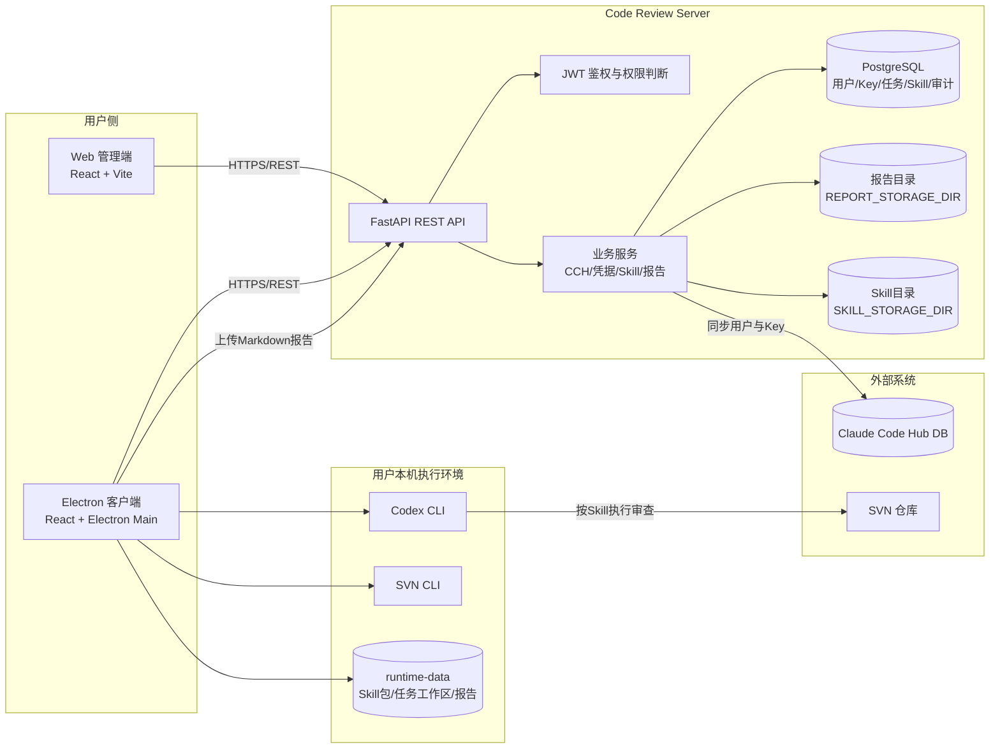
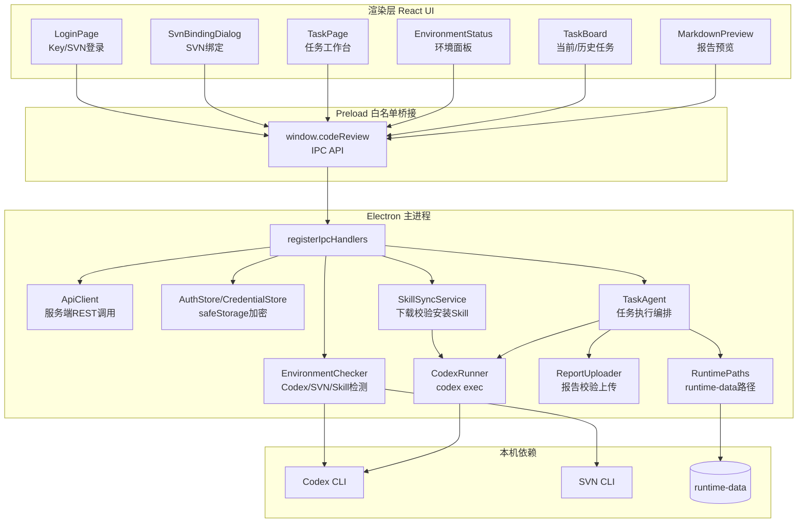
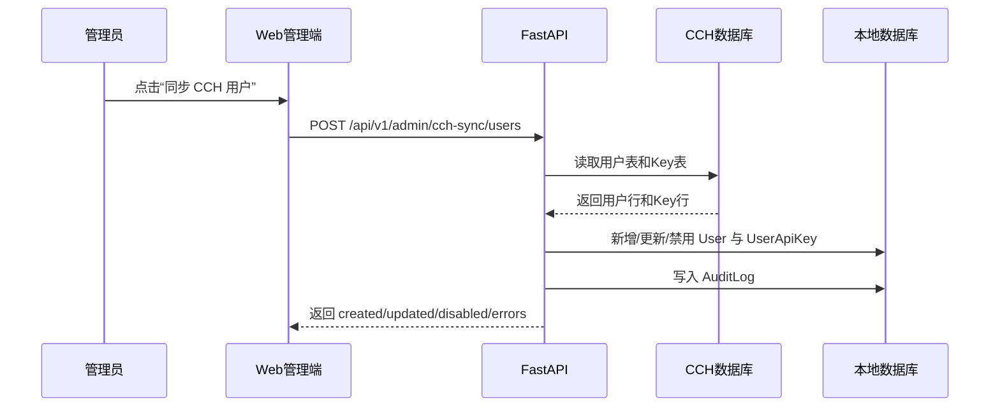
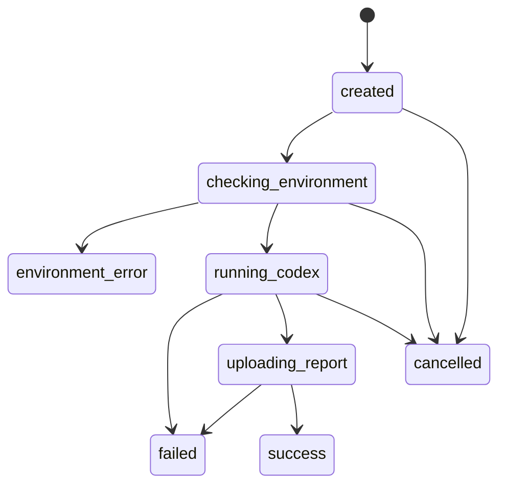
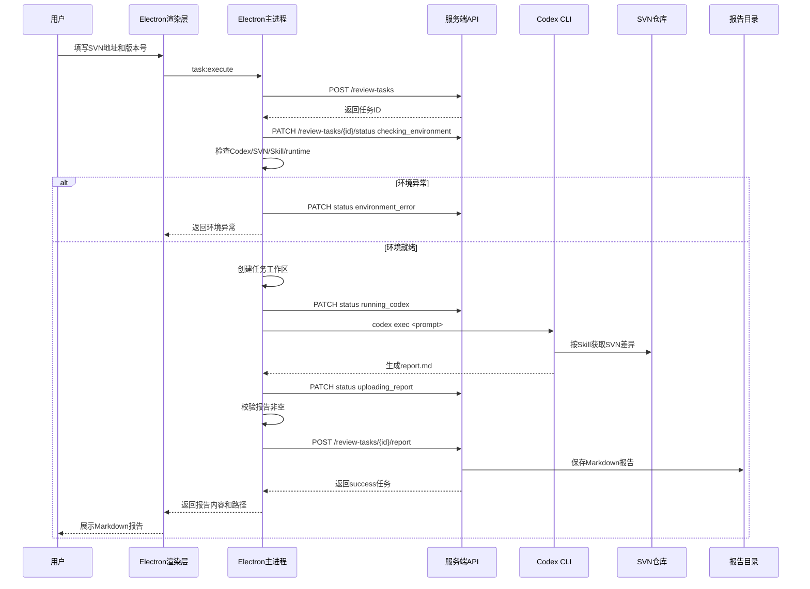
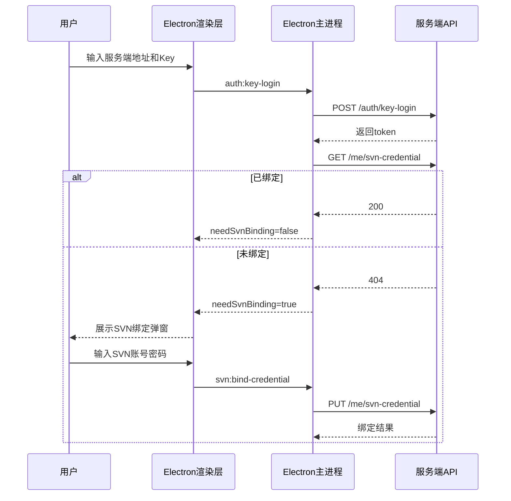

# AI代码审查平台系统设计文档

> 版本：v1.0.0

> 编写日期：2026-06-04

# 项目概述

## 项目背景

当前团队的 SVN 代码变更审查依赖人工拉取差异、执行规则检查和整理 Markdown 报告，过程分散且难以追踪任务状态、审查结果和报告归档。代码审查平台通过服务端集中管理用户、权限、审查任务、Skill 包和报告，由 Electron 客户端在用户本机调起 Codex 执行审查，从而兼顾任务统一管理和本地 SVN 环境隔离。

## 项目目标

1.  支持管理员从 Claude Code Hub（以下简称 CCH）同步用户、角色和 Key。
    
2.  支持 Web 管理端和 Electron 客户端通过 Key 或 SVN 账号密码登录。
    
3.  支持用户绑定 SVN 凭据，服务端加密保存 SVN 密码。
    
4.  支持用户提交 SVN 代码审查任务，记录任务状态、客户端信息、错误原因和审查报告。
    
5.  支持 Electron 客户端检查本机 Codex CLI、SVN CLI、审查 Skill 和运行目录。
    
6.  支持 Electron 客户端调用 Codex 已安装的 `通用-代码变更审查` Skill 生成 Markdown 报告。
    
7.  支持管理员上传、激活和分发审查 Skill zip 包。
    
8.  支持 Web 管理端查看任务统计、任务列表、用户管理、Skill 管理和报告下载。
    

## 项目范围

| 功能模块 | 包含内容 | 不包含内容 |
| --- | --- | --- |
| 用户与权限 | CCH 用户同步、本地用户管理、管理员/普通用户权限、JWT 鉴权 | 邮箱注册、邮箱登录、找回密码、复杂组织权限模型 |
| 登录认证 | Key 登录、SVN 账号密码登录、Electron 本地加密保存 token 和记住的登录信息 | OAuth、短信验证码、第三方 SSO |
| SVN 凭据 | 用户绑定 SVN 账号密码、服务端 Fernet 加密保存密码、读取凭据审计记录 | 服务端直接执行 SVN diff、明文保存密码 |
| 审查任务 | 创建任务、状态更新、任务统计、任务列表、报告上传/读取/下载/删除 | 任务排队调度中心、服务端异步执行审查、多人协同审查 |
| Electron 执行 | 本机环境检查、Skill 同步、创建任务工作区、调用 Codex CLI、上传报告 | 内置 Codex CLI、内置 SVN CLI、客户端自行解析 SVN diff |
| Skill 管理 | 管理员上传 zip、校验 `SKILL.md`、保存原始包、激活单个 Skill、客户端下载 active Skill | 多 Skill 策略选择、Skill 在线编辑、规则市场 |
| Web 管理端 | 首页统计、任务管理、用户管理、Skill 库、SVN 凭据设置 | 审查报告在线批注、复杂趋势分析、部门业务重构 |
| 部署运维 | Docker Compose、PostgreSQL、报告和 Skill 持久化卷、Sentry 可选接入 | Kubernetes Helm、自动扩缩容、全链路日志平台 |

# 需求分析

## 功能需求（FR）

| 需求ID | 功能描述 | 输入/输出 | 详细说明 |
| --- | --- | --- | --- |
| FR-001 | CCH 用户同步 | 输入：CCH PostgreSQL 连接串；输出：本地用户和 Key 记录 | 管理员调用同步接口，从 CCH 表中读取用户和 Key，新增、更新或禁用本地记录，并写入审计日志。 |
| FR-002 | Key 登录 | 输入：CCH 同步得到的 Key；输出：access token、refresh token | Web 管理端和 Electron 客户端均可使用 Key 登录；Key 必须存在、启用且关联用户处于启用状态。 |
| FR-003 | SVN 登录 | 输入：SVN 账号、SVN 密码；输出：access token、refresh token | 服务端按 `User.svn_username` 查找用户，解密保存的 SVN 密码并与输入比对。 |
| FR-004 | SVN 凭据绑定 | 输入：SVN 账号、SVN 密码；输出：绑定后的 SVN 凭据 | 用户可在 Web 设置页或 Electron 弹窗绑定 SVN 凭据；若账号已绑定本地用户，需要校验既有密码后合并用户。 |
| FR-005 | 审查任务创建 | 输入：SVN 地址、旧版本号、新版本号；输出：任务记录 | 后端校验版本号为数字或 `r数字`，规范化为 `r123` 形式，旧新版本号不得相同。 |
| FR-006 | 审查任务状态流转 | 输入：任务 ID、状态、错误信息、客户端信息；输出：更新后的任务 | Electron 客户端按执行阶段更新 `checking_environment`、`running_codex`、`uploading_report`、`success`、`failed`、`environment_error` 等状态。 |
| FR-007 | 本机环境检查 | 输入：本机运行环境；输出：Codex/SVN/Skill 状态 | Electron 检查 `codex --version`、`svn --version --quiet`、runtime 目录可写性和 Skill manifest。 |
| FR-008 | Codex 执行审查 | 输入：任务信息、报告路径；输出：Markdown 报告文件 | Electron 通过 `codex exec --dangerously-bypass-approvals-and-sandbox` 调用已安装 Skill，最长执行 30 分钟。 |
| FR-009 | 报告上传与归档 | 输入：Markdown 报告文件；输出：服务端报告路径和成功任务状态 | 客户端校验报告存在且非空后上传；服务端保存到 `REPORT_STORAGE_DIR/<taskId>.md`。 |
| FR-010 | 报告查看和下载 | 输入：任务 ID；输出：Markdown 文本或下载文件 | 用户只能访问自己的任务报告，管理员可访问所有任务报告。 |
| FR-011 | 任务统计 | 输入：当前登录用户；输出：总数、成功数、运行中数、失败/异常数、状态分布 | 普通用户只统计本人任务，管理员统计全部任务，并按用户统计报告生成数。 |
| FR-012 | Skill 管理 | 输入：Skill zip、名称、版本、描述、是否激活；输出：Skill 元数据 | 管理员上传 zip，服务端校验包内存在 `SKILL.md`，保存 content hash、file size 和原始 zip。 |
| FR-013 | Skill 同步 | 输入：active Skill 元数据和 zip；输出：本地已安装 Skill manifest | Electron 下载 active Skill，校验 hash 和 file size 后调用 Codex 安装，并写入本地 manifest。 |
| FR-014 | 任务删除 | 输入：任务 ID；输出：删除结果 | 有权限的用户可删除任务；若报告文件存在，先删除报告文件，再删除数据库记录。 |
| FR-015 | Electron 登录工作台 | 输入：服务端地址、Key 或 SVN 账号密码；输出：已登录的本地任务工作台 | 客户端启动后先进入登录页，支持加载上次服务端地址、记住的 Key/SVN 凭据，登录成功后进入任务工作台。 |
| FR-016 | Electron 环境状态面板 | 输入：本机依赖检测结果；输出：依赖状态、版本、路径和安装入口 | 工作台显示 Codex CLI、SVN CLI、代码审查 Skill 的就绪状态；Codex 缺失时先只展示 Codex 问题。 |
| FR-017 | Electron 自动安装辅助 | 输入：用户点击安装 Codex/SVN/Skill；输出：安装结果和刷新后的环境状态 | Codex 通过已有 npm 安装；SVN 在 Windows 使用 winget、macOS 使用 Homebrew；Skill 从服务端下载 active zip 后交给 Codex 安装。 |
| FR-018 | Electron 任务工作台 | 输入：SVN 地址、旧版本号、新版本号；输出：任务进度、当前任务、历史任务和报告预览 | 环境未就绪时禁用新建任务；任务运行时展示阶段进度和 Codex 输出；成功后展示 Markdown 报告。 |
| FR-019 | Electron 报告本地查看 | 输入：当前任务或历史任务 ID；输出：右侧 Markdown 预览和本地报告位置 | 可从服务端读取历史报告，可将报告写入本地任务工作区并调用系统文件管理器定位。 |

## 非功能需求（NF）

| 需求ID | 需求描述 | 详细说明 | 验收标准 |
| --- | --- | --- | --- |
| NF-001 | 权限隔离 | 普通用户只能查看、删除、下载自己的任务和报告；管理员可管理全量数据 | 后端接口对任务详情、列表、报告、下载、删除、状态更新均执行权限判断。 |
| NF-002 | 凭据安全 | SVN 密码和 Electron 本地 token/登录信息不得明文落盘 | 服务端使用 `SVN_CREDENTIAL_MASTER_KEY` 派生 Fernet key 加密 SVN 密码；Electron 使用 `safeStorage` 保存敏感信息。 |
| NF-003 | 报告完整性 | 不允许空报告被上传为成功结果 | 客户端和服务端均校验报告文件非空；服务端空文件上传返回 400。 |
| NF-004 | Skill 完整性 | 客户端不得安装 hash 或文件大小不匹配的 Skill 包 | `content_hash` 不一致必须中断同步；`file_size` 存在且不一致也必须中断。 |
| NF-005 | 可追踪性 | 任务执行阶段、错误信息、报告路径、客户端信息需要可查询 | `ReviewTask` 保存状态、错误、报告路径、客户端 hostname/version 和关键时间字段。 |
| NF-006 | 可维护性 | 服务端、Web 前端、Electron 客户端职责边界清晰 | 服务端不执行 SVN diff；Electron 不保存服务端数据库；Codex Skill 负责审查规则和报告生成。 |
| NF-007 | 可部署性 | 服务端支持容器化部署和持久化数据目录 | Docker Compose 启动 PostgreSQL、backend、frontend，并挂载 `/app/reports` 与 `/app/skills`。 |
| NF-008 | 兼容性 | Electron 环境检查覆盖 Windows/macOS 常见路径 | 命令查找包含 `%APPDATA%/npm`、Homebrew、`/usr/local/bin`、`/usr/bin` 等路径。 |
| NF-009 | 错误可读性 | 用户应看到面向操作的错误信息，而不是原始敏感堆栈 | Electron 将 Codex 错误码映射为中文提示，并脱敏 token、password、路径等敏感信息。 |
| NF-010 | 客户端易用性 | 用户不应需要理解后端接口才能完成审查 | Electron 将登录、环境准备、任务提交、报告查看收敛在单一任务工作台，并提供联系管理员入口。 |
| NF-011 | 客户端安全边界 | 渲染层不得直接访问 Node.js、文件系统或 shell | Electron 通过 preload 暴露白名单 IPC API，主进程统一执行本地文件、命令和系统打开操作。 |

## 验收标准

| 测试项 | 验收标准 | 测试方法 |
| --- | --- | --- |
| Key 登录 | 有效且启用的 Key 可登录；无效或禁用 Key 返回 401 | 调用 `/api/v1/auth/key-login`，覆盖成功、无效、禁用用户场景。 |
| SVN 登录 | 已绑定凭据用户可登录；密码错误返回 401 | 调用 `/api/v1/auth/login`，校验服务端解密密码后比对。 |
| 权限隔离 | 普通用户无法读取或删除其他用户任务和报告 | 使用两个普通用户创建任务，交叉访问应返回 403 或 404。 |
| 任务状态 | 任务从创建到成功时写入 `started_at`、`finished_at`、`updated_at` | 调用状态更新和报告上传接口，检查数据库记录。 |
| 环境检查 | Codex 缺失时返回 `missing_codex`，Codex 就绪后继续检查 SVN 和 Skill | Mock 命令查找结果执行 Electron 主进程测试。 |
| 报告上传 | 空报告拒绝；非空 Markdown 上传后任务置为 `success` | 调用 `/review-tasks/{id}/report` 上传空文件和有效文件。 |
| Skill 上传 | 非 zip、无 `SKILL.md`、路径穿越包均被拒绝 | 构造不同 zip 包调用 `/api/v1/skills`。 |
| Skill 同步 | hash 或 file size 不匹配时客户端拒绝安装 | Mock active Skill 元数据和下载内容执行 Electron 测试。 |
| Web 任务管理 | 普通用户只看本人任务；管理员可筛选用户姓名和 SVN 账号 | Playwright 打开任务页面，校验列表、筛选、删除、报告按钮。 |
| Electron 执行 | 环境 ready 时可创建任务、执行 Codex、上传报告并预览 Markdown | 使用可控 Codex runner mock 或集成环境执行端到端验证。 |

# 架构设计

## 系统架构



系统采用“服务端集中管理 + 客户端本机执行”的架构：

*   服务端负责账户、权限、任务、报告、Skill 包、审计和 Web API。
    
*   Web 管理端负责管理与查询。
    
*   Electron 客户端负责本机环境检查、任务提交、调用 Codex 和上传报告。
    
*   Codex Skill 负责 SVN 差异获取、规则执行和 Markdown 报告生成。
    

## 环境依赖

| 组件 | 型号/版本 | 说明 |
| --- | --- | --- |
| Python | `>=3.10,<4.0` | 服务端运行环境。 |
| FastAPI | `>=0.114.2,<1.0.0` | 后端 API 框架。 |
| SQLModel | `>=0.0.21,<1.0.0` | ORM 与 Pydantic 模型定义。 |
| PostgreSQL | Compose 使用 `postgres:18` | 存储用户、Key、任务、Skill、审计日志。 |
| Alembic | `>=1.12.1,<2.0.0` | 数据库迁移。 |
| cryptography | `>=43.0.0,<46.0.0` | SVN 凭据 Fernet 加密。 |
| React | Web：`19.1.1`；Electron：`19.2.0` | 前端界面。 |
| Vite | Web：`7.3.0`；Electron：`7.2.4` | 前端构建和开发服务。 |
| Electron | `39.2.6` | 桌面客户端运行壳。 |
| Codex CLI | 本机安装 | Electron 调用 `codex exec` 执行审查 Skill。 |
| SVN CLI | 本机安装 | Codex Skill 执行 SVN 操作需要。 |
| Docker Compose | 生产/开发部署 | 启动 db、backend、frontend、prestart 等服务。 |
| Traefik | 可选 | 生产 HTTPS 反向代理。 |

关键环境变量：

| 环境变量 | 所属组件 | 说明 |
| --- | --- | --- |
| `SECRET_KEY` | backend | JWT 签名密钥，生产必须显式设置。 |
| `POSTGRES_SERVER` / `POSTGRES_PORT` / `POSTGRES_USER` / `POSTGRES_PASSWORD` / `POSTGRES_DB` | backend/db | PostgreSQL 连接配置。 |
| `CCH_DATABASE_URL` | backend | CCH PostgreSQL 连接串，用于同步用户和 Key。 |
| `SVN_CREDENTIAL_MASTER_KEY` | backend | SVN 凭据加密主密钥，生产必须稳定保存。 |
| `REPORT_STORAGE_DIR` | backend | Markdown 报告持久化目录，默认 `/app/reports`。 |
| `SKILL_STORAGE_DIR` | backend | Skill 包持久化目录，默认 `/app/skills`。 |
| `FRONTEND_HOST` / `BACKEND_CORS_ORIGINS` | backend | CORS 来源配置。 |
| `CODE_REVIEW_API_BASE_URL` | Electron | 客户端默认服务端地址，未设置时使用代码中的默认地址。 |

部署注意事项：`compose.yml` 已挂载 `/app/reports` 和 `/app/skills` 持久化卷；生产环境需要确认 `CCH_DATABASE_URL` 与 `SVN_CREDENTIAL_MASTER_KEY` 已通过 `.env` 或部署平台透传给 backend。

## 软件架构

| 层级 | 模块 | 职责 | 实现方式 |
| --- | --- | --- | --- |
| 接入层 | FastAPI 路由 | 暴露登录、用户、凭据、任务、Skill、同步等 REST API | `backend/app/api/routes/*.py` |
| 鉴权层 | JWT 与角色判断 | 解析 Bearer token，区分管理员和普通用户 | `backend/app/api/deps.py`、`backend/app/core/security.py` |
| 业务服务层 | CCH、凭据、Skill、报告服务 | 封装同步、加密、上传、激活、文件保存等业务逻辑 | `backend/app/services/*.py` |
| 数据层 | SQLModel 模型与 Alembic | 定义用户、Key、任务、Skill、审计日志等表结构 | `backend/app/models.py`、`backend/app/alembic` |
| Web 表现层 | 管理后台 | 首页统计、用户管理、任务管理、Skill 管理、设置页 | `code_review_server/frontend/src` |
| Electron 主进程 | 本地能力封装 | IPC、环境检查、Codex 调用、Skill 同步、报告上传、本地安全存储 | `code_review_electron/src/main` |
| Electron 渲染层 | 桌面 UI | 登录、SVN 绑定、任务工作台、任务看板、Markdown 预览 | `code_review_electron/src/renderer` |
| 外部执行层 | Codex Skill | SVN 差异获取、规则审查、Markdown 报告生成 | 本机安装的 `通用-代码变更审查` Skill |

## Electron 客户端内部架构



客户端采用三层边界：

*   渲染层只负责界面状态和用户交互。
    
*   preload 只暴露 `window.codeReview` 白名单，不开放任意 Node.js 能力。
    
*   主进程负责服务端通信、本地命令、本地加密存储、文件读写和系统打开操作。
    

# 详细设计

## 模块划分

| 模块 | 职责 | 文件结构 | 关键函数/接口 |
| --- | --- | --- | --- |
| 用户模型模块 | 定义用户、角色、认证来源、Key、SVN 凭据 | `backend/app/models.py` | `User`、`UserRole`、`AuthSource`、`UserApiKey`、`UserSvnCredential` |
| 鉴权模块 | 生成和校验 JWT，判断管理员权限 | `backend/app/core/security.py`、`backend/app/api/deps.py` | `create_access_token()`、`get_current_user()`、`has_admin_privileges()` |
| 登录模块 | Key 登录、SVN 登录、token 测试 | `backend/app/api/routes/login.py` | `login_with_key()`、`login_svn_account()`、`test_token()` |
| CCH 同步模块 | 从 CCH DB 同步用户和 Key | `backend/app/api/routes/cch_sync.py`、`backend/app/services/cch_sync_service.py` | `sync_cch_users()`、`CchSyncService.sync_from_database()` |
| SVN 凭据模块 | 绑定、读取、加密保存 SVN 凭据 | `backend/app/api/routes/credentials.py`、`backend/app/services/credential_service.py` | `update_my_svn_credential()`、`save_svn_password()`、`get_svn_password()` |
| 审查任务模块 | 创建、查询、统计、更新状态、上传报告、删除任务 | `backend/app/api/routes/review_tasks.py` | `create_review_task()`、`read_review_tasks()`、`read_review_task_stats()`、`update_review_task_status()` |
| 报告服务模块 | 保存报告文件，生成任务报告路径 | `backend/app/services/report_service.py` | `path_for_task()`、`save_upload()` |
| Skill 服务模块 | 保存、校验、读取、激活 Skill 包 | `backend/app/api/routes/skills.py`、`backend/app/services/skill_service.py` | `upload_skill()`、`download_active_skill()`、`save_upload()`、`activate_skill()` |
| Web 管理端 | 展示管理后台页面 | `code_review_server/frontend/src/components`、`src/routes` | `TasksPage`、`AdminUsersPage`、`AdminSkillsPage`、`TaskStatsPanel` |
| Electron IPC 模块 | 将渲染层请求转发到主进程能力 | `code_review_electron/src/main/ipc.ts`、`src/preload/index.ts` | `registerIpcHandlers()`、`contextBridge.exposeInMainWorld()` |
| Electron API 客户端 | 调用服务端 REST API | `code_review_electron/src/main/api-client.ts` | `keyLogin()`、`svnLogin()`、`createTask()`、`uploadReport()` |
| Electron 环境检查 | 检测 Codex/SVN/Skill/runtime | `code_review_electron/src/main/environment-checker.ts` | `checkEnvironment()`、`findVersionCommand()`、`classifyEnvironment()` |
| Electron 任务执行 | 创建任务、更新状态、运行 Codex、上传报告 | `code_review_electron/src/main/task-agent.ts` | `executeReviewTask()`、`defaultRunCodex()`、`defaultPrepareWorkspace()` |
| Codex 调用模块 | 构造 prompt、调用 `codex exec`、解析错误码 | `code_review_electron/src/main/codex-runner.ts` | `buildReviewPrompt()`、`runCodexReview()`、`parseCodexError()` |
| Electron Skill 同步 | 下载 active Skill，校验并安装 | `code_review_electron/src/main/skill-sync.ts` | `SkillSyncService.sync()` |
| Electron 本地存储 | 加密保存 token、记住的凭据和服务端地址 | `auth-store.ts`、`credential-store.ts`、`server-config-store.ts` | `AuthStore.save()`、`CredentialStore.save()`、`ServerConfigStore.load()` |

## 核心模块

### 用户、角色与登录

用户表使用 UUID 作为主键，支持两类来源：

*   `local`：本地创建或 SVN 账号合并产生的用户。
    
*   `cch`：从 CCH 同步得到的用户。
    

角色由 `UserRole` 表示：

*   `admin`：管理员。
    
*   `user`：普通用户。
    

管理员权限判断同时认可 `is_superuser == true` 或 `role == admin`。登录成功后服务端返回 access token 和 refresh token，当前代码中 access token 有效期为 8 天，refresh token 有效期为 30 天。

### CCH 用户同步

CCH 同步由管理员手动触发：



同步服务会自动识别候选表名，例如用户表候选 `cch_user`、`cch_users`、`users`、`user`，Key 表候选 `cch_key`、`cch_keys`、`user_api_key`、`api_keys`、`keys`。用户或 Key 被删除、禁用、过期时，本地记录会标记为不可用并保存 `disabled_reason`。

### SVN 凭据加密与绑定

SVN 密码通过 `CredentialService` 保存到 `user_svn_credential` 表。加密流程：

1.  读取 `SVN_CREDENTIAL_MASTER_KEY`。
    
2.  对 master key 做 SHA-256。
    
3.  将摘要编码为 Fernet key。
    
4.  使用 Fernet 加密 SVN 密码。
    
5.  保存 `encrypted_password` 和 `encryption_version = fernet-sha256-v1`。
    

绑定时的特殊逻辑：

*   当前用户未绑定时，直接保存 SVN 账号和密码。
    
*   如果 SVN 账号已被其他本地用户占用，则必须用该账号既有 SVN 密码校验通过后，才允许把旧用户合并到当前用户。
    
*   如果 SVN 账号属于 CCH 来源用户或校验失败，则拒绝绑定。
    

### 审查任务状态机

任务状态定义如下：

| 状态 | 说明 | 进入方式 |
| --- | --- | --- |
| `created` | 任务已创建，尚未开始执行 | 服务端创建任务默认状态 |
| `checking_environment` | 客户端正在检查本机环境 | Electron 开始执行后更新 |
| `running_codex` | 客户端正在调用 Codex 执行审查 | 环境检查通过后更新 |
| `uploading_report` | 客户端正在上传报告 | Codex 执行完成后更新 |
| `success` | 审查成功，报告已归档 | 报告上传接口自动置为成功 |
| `failed` | 执行失败 | Codex 或客户端流程异常 |
| `environment_error` | 本机环境缺失或不可用 | 环境检查不通过 |
| `cancelled` | 任务取消 | 预留状态，当前未看到前端主动取消入口 |

状态流转：



服务端在状态非 `created` 且 `started_at` 为空时写入开始时间；进入 `success`、`failed`、`environment_error`、`cancelled` 时写入完成时间。

### Electron 客户端设计

Electron 客户端是普通用户实际发起代码审查的主入口。它的定位不是“管理后台的桌面版”，而是一个本机执行工作台：负责登录服务端、准备本机依赖、提交审查任务、调度 Codex Skill、展示任务进度和报告结果。

#### 客户端页面结构

| 页面/区域 | 主要功能 | 关键组件 | 说明 |
| --- | --- | --- | --- |
| 登录页 | 输入服务端地址，选择 Key 登录或 SVN 登录，支持记住凭据 | `LoginPage`、`PasswordField`、`AdminContactDialog` | 默认展示 Key 登录；启动时读取上次服务端地址和加密保存的凭据。 |
| SVN 绑定弹窗 | Key 登录后引导用户绑定 SVN 账号密码 | `SvnBindingDialog` | Key 用户没有 SVN 凭据时弹出；允许跳过，但下次 Key 登录仍会检测。 |
| 任务工作台左栏 | 显示品牌、当前用户、环境状态、新建任务、任务看板 | `TaskPage`、`EnvironmentStatus`、`TaskForm`、`TaskBoard` | 环境未就绪时禁用“开始审查”。 |
| 环境状态面板 | 展示 Codex/SVN/Skill 是否就绪，并提供安装按钮 | `EnvironmentStatus` | 以 Codex 为第一阶段检查，Codex 缺失时不继续展示 SVN 和 Skill 问题。 |
| 新建任务表单 | 填写 SVN 地址、旧版本号、新版本号 | `TaskForm` | 表单仅做必填和 trim，版本号规范化由服务端完成。 |
| 任务看板 | 切换当前任务和历史任务，查看状态、进度和报告入口 | `TaskBoard` | 当前任务展示最近一次任务和最近 Codex 输出；历史任务隐藏日志，保持紧凑。 |
| 报告预览区 | 渲染当前或历史任务 Markdown 报告，打开本地报告位置 | `MarkdownPreview` | 使用 `react-markdown` + `remark-gfm`，支持表格、代码块、链接和渲染失败兜底。 |

客户端主界面是左右布局：

*   左侧是任务操作区，包含环境检查、新建任务和任务看板。
    
*   右侧是报告阅读区，始终用于展示当前选中的 Markdown 报告。
    
*   任务执行过程中，左侧看板负责展示阶段变化；右侧只在报告生成或用户查看历史报告时更新。
    

#### 登录与本地会话

客户端支持两种登录模式：

1.  Key 登录：用户输入服务端地址和 Key，主进程调用 `/api/v1/auth/key-login`。登录成功后立即调用 `/api/v1/me/svn-credential` 判断是否已绑定 SVN 凭据。
    
2.  SVN 登录：用户输入服务端地址、SVN 账号和 SVN 密码，主进程调用 `/api/v1/auth/login`。
    

登录成功后，主进程将 token pair 写入 `auth.bin`。如果用户勾选“记住密码”，客户端会将 Key 或 SVN 登录信息写入 `remembered-credentials.bin`。这两个文件都通过 Electron `safeStorage` 加密保存，渲染层不直接接触文件路径或加解密细节。

服务端地址由 `ServerConfigStore` 保存到 `server-config.json`。启动时优先读取已保存配置；没有配置时使用 `CODE_REVIEW_API_BASE_URL` 或代码中的默认地址。

#### 环境检查与安装辅助

环境检查由主进程统一执行，渲染层只接收结构化结果：

| 状态 | 含义 | 用户可见处理 |
| --- | --- | --- |
| `ready` | Codex CLI、SVN CLI、Skill 和 runtime 均可用 | 允许提交审查任务。 |
| `missing_codex` | 找不到 Codex CLI | 只展示 Codex 问题和“安装 Codex CLI”按钮。 |
| `missing_svn` | 找不到 SVN CLI | 展示 SVN 问题和“安装 SVN CLI”按钮。 |
| `missing_skill` | 本地 Skill manifest 不存在或指向的包不可用 | 展示 Skill 问题和“安装”按钮。 |
| `failed` | runtime 不可写或检查过程异常 | 展示检查失败原因，禁止提交任务。 |

检查顺序采用分阶段策略：

1.  读取客户端 runtime 路径。
    
2.  检查 runtime 目录可写。
    
3.  检查 Codex CLI。
    
4.  Codex 缺失时直接返回，不继续检查 SVN 和 Skill。
    
5.  Codex 就绪后并行检查 SVN CLI 和 Skill manifest。
    

自动安装能力：

*   Codex CLI：先查找 npm；未找到 npm 时提示先安装 Node.js；找到后执行 `npm install -g @openai/codex`，再执行 `codex --version` 验证。
    
*   SVN CLI：Windows 使用 `winget install -e --id Slik.Subversion`，macOS 使用 `brew install subversion`，其他系统提示暂不支持自动安装。
    
*   Skill：先从服务端同步 active Skill，再调用 Codex 安装 zip 包。
    

安装命令失败时，客户端会提取权限、网络、registry、证书、代理等可操作错误行，并脱敏 token、password、URL 中的认证信息和本地路径。

#### 本地运行目录

客户端运行数据由 `runtime-paths.ts` 统一生成：

```plaintext
打包环境：
<客户端exe所在目录>/runtime-data/
├── skill-packages/
│   ├── manifest.json
│   └── <skillId>-<version>-<hash>.zip
└── workspaces/
    └── <taskId>/
        └── report.md

开发环境：
code_review_electron/.runtime-data/
├── skill-packages/
└── workspaces/
```

设计原则：

*   Skill zip 缓存在客户端目录下，便于定位、迁移和排查。
    
*   每个审查任务拥有独立工作区，避免不同任务的报告互相覆盖。
    
*   工作区只保存任务运行产物，不复制 Skill 目录。
    
*   报告默认输出到 `runtime-data/workspaces/<taskId>/report.md`。
    

#### 任务看板与报告预览

任务看板使用两个视图：

| 视图 | 数据来源 | 展示内容 |
| --- | --- | --- |
| 当前任务 | `tasks[0]`，即最近一次提交或服务端返回的最新任务 | 任务 ID、SVN 地址、版本号、状态、进度消息、错误信息、查看报告按钮、最近 Codex 输出。 |
| 历史任务 | `tasks.slice(1)` | 任务摘要、状态、进度/错误摘要、查看报告按钮，不展示 Codex 实时日志。 |

任务进度事件分两类：

*   `stage`：阶段消息，例如“检查本机环境”“启动 Codex 执行审查 Skill”“上传审查报告”。
    
*   `codex_output`：Codex stdout/stderr 输出，当前任务只保留最近 20 条，界面显示最近几条。
    

报告预览使用 React 组件直接渲染 Markdown：

*   支持 GFM 表格、任务列表、删除线和自动链接。
    
*   代码块保留缩进和横向滚动，带语言标签。
    
*   表格外层横向滚动，避免撑破预览区。
    
*   链接仅允许 `http:`、`https:`、`mailto:`，不允许危险协议。
    
*   渲染异常时提示用户下载原始 Markdown 查看。
    

#### 客户端安全边界

Electron 客户端采用主进程集中能力、渲染层白名单调用的安全边界：

*   渲染层通过 `window.codeReview` 调用 preload 暴露的 API。
    
*   文件读写、命令执行、token 保存、报告定位均在主进程完成。
    
*   主窗口启用 `contextIsolation: true`。
    
*   外链打开由 `window-security.ts` 接管，只允许安全协议，并阻止 Electron 页面直接跳转。
    
*   客户端不会把 token、SVN 密码或本地路径原样写入任务错误摘要。
    

### Electron 本机执行流程

Electron 客户端执行任务的主流程位于 `executeReviewTask()`：

1.  调用服务端创建任务。
    
2.  更新任务为 `checking_environment`。
    
3.  检查 Codex CLI、SVN CLI、Skill manifest 和 runtime 目录可写性。
    
4.  环境失败时更新为 `environment_error` 并返回。
    
5.  创建 `runtime-data/workspaces/<taskId>` 工作区。
    
6.  构造 Codex prompt，要求使用本机已安装的 `通用-代码变更审查` Skill。
    
7.  更新任务为 `running_codex`。
    
8.  调用 `codex exec --dangerously-bypass-approvals-and-sandbox <prompt>`。
    
9.  更新任务为 `uploading_report`。
    
10.  校验 `report.md` 存在且非空。
    
11.  上传报告到服务端。
    
12.  返回 Markdown 内容和本地报告路径，渲染层展示报告。
    

客户端不会直接执行 `svn diff`，也不会在主进程拼接 SVN 差异。SVN 获取、规则审查和报告生成均交给 Codex Skill。

### Codex 错误处理

Prompt 约定 Codex 在穷尽 Skill 内置恢复策略后，按如下格式输出错误：

```plaintext
[CODEX_ERROR::<错误码>] <具体错误描述>

```

客户端识别的错误码：

| 错误码 | 用户提示语义 |
| --- | --- |
| `SVN_ERROR` | SVN 操作失败，提示检查项目路径和版本号。 |
| `SKILL_ERROR` | Skill 执行异常或缺失，提示联系管理员。 |
| `PARAM_ERROR` | 输入参数无效。 |
| `REPORT_ERROR` | 报告生成失败。 |
| `INTERNAL_ERROR` | Codex 执行出现未预期错误。 |

非结构化错误会经过 `sanitizeErrorSummary()` 脱敏，移除 token、password、secret、Bearer token 和本地路径片段。

### Skill 管理与分发

服务端 Skill 上传流程：

1.  管理员上传 zip。
    
2.  服务端读取 zip 内容，计算 SHA-256。
    
3.  校验 zip 非空、路径合法、包内存在 `SKILL.md`。
    
4.  保存原始 zip 为 `.original-skill.zip`。
    
5.  解压可用内容到 Skill 目录，用于校验和回包。
    
6.  记录 `SkillPackage` 元数据。
    
7.  如果 `activate=true`，停用其他 active Skill，并激活当前 Skill。
    

客户端下载流程：

1.  调用 `/api/v1/skills/active` 获取 active Skill 元数据。
    
2.  若本地 manifest 的 id/version/hash/file\_size 与服务端一致，且 zip 存在并校验通过，则跳过下载。
    
3.  否则调用 `/api/v1/skills/active/download` 下载 zip。
    
4.  校验 hash 和 file size。
    
5.  保存到 `runtime-data/skill-packages/<skillId>-<version>-<hash>.zip`。
    
6.  调用 Codex Skill 安装适配层安装 zip。
    
7.  写入 `runtime-data/skill-packages/manifest.json`。
    

### 报告存储

服务端报告路径规则：

```text
REPORT_STORAGE_DIR/<taskId>.md

```

报告上传成功后：

*   `ReviewTask.report_path` 保存服务端绝对路径。
    
*   `ReviewTask.status` 更新为 `success`。
    
*   `finished_at` 和 `updated_at` 更新为当前 UTC 时间。
    

读取报告时，服务端返回 `text/markdown`。下载报告时，文件名为：

```text
review-task-<taskId>.md

```

删除任务时，如果报告文件存在，先删除文件，再删除任务记录；文件删除失败时返回 500，数据库记录保持不变。

## 数据流

### 审查任务执行数据流



### Key 登录后 SVN 绑定数据流



# 接口定义

## 硬件接口

本系统为 Web 服务与桌面客户端软件系统，不涉及硬件管脚或外设接口。

| 接口 | 信号 | 引脚 | 说明 |
| --- | --- | --- | --- |
| 无 | 无 | 无 | 不适用。 |

## 软件接口

### 服务端 REST API

| 接口 | 方法与路径 | 参数 | 返回值 | 说明 |
| --- | --- | --- | --- | --- |
| Key 登录 | `POST /api/v1/auth/key-login` | body：`{ "key": string }` | `AuthToken` | 使用 CCH 同步 Key 登录。 |
| SVN 登录 | `POST /api/v1/auth/login` | body：`{ "svn_username": string, "svn_password": string }` | `AuthToken` | 使用服务端已保存的 SVN 凭据登录。 |
| token 测试 | `POST /api/v1/login/test-token` | Bearer token | `UserPublic` | 校验当前 token 并返回用户。 |
| 获取用户列表 | `GET /api/v1/users/` | `skip`、`limit` | `UsersPublic` | 管理员接口。 |
| 创建用户 | `POST /api/v1/users/` | `UserCreate` | `UserPublic` | 管理员接口。 |
| 获取当前用户 | `GET /api/v1/users/me` | Bearer token | `UserPublic` | 当前登录用户信息。 |
| 更新当前用户 | `PATCH /api/v1/users/me` | `UserUpdateMe` | `UserPublic` | 更新本人基础信息。 |
| 更新用户 | `PATCH /api/v1/users/{user_id}` | `UserUpdate` | `UserPublic` | 管理员接口。 |
| 删除用户 | `DELETE /api/v1/users/{user_id}` | `user_id` | `Message` | 管理员接口。 |
| 读取 SVN 凭据 | `GET /api/v1/me/svn-credential` | Bearer token | `SvnCredentialPublic` | 返回当前用户 SVN 账号和解密后的 SVN 密码，并写审计日志。 |
| 更新 SVN 凭据 | `PUT /api/v1/me/svn-credential` | `SvnCredential` | `SvnCredentialPublic` | 绑定或更新 SVN 凭据。 |
| 同步 CCH 用户 | `POST /api/v1/admin/cch-sync/users` | Bearer token | `CchSyncResultPublic` | 管理员接口，从 CCH DB 同步用户和 Key。 |
| 创建审查任务 | `POST /api/v1/review-tasks` | `ReviewTaskCreate` | `ReviewTaskPublic` | 创建当前用户任务。 |
| 查询任务列表 | `GET /api/v1/review-tasks` | `skip`、`limit`、`user_name`、`svn_username` | `ReviewTasksPublic` | 普通用户仅本人，管理员全量。 |
| 查询任务统计 | `GET /api/v1/review-tasks/stats` | Bearer token | `ReviewTaskStatsPublic` | 按权限范围统计任务。 |
| 查询任务详情 | `GET /api/v1/review-tasks/{task_id}` | `task_id` | `ReviewTaskPublic` | 按权限读取。 |
| 删除任务 | `DELETE /api/v1/review-tasks/{task_id}` | `task_id` | `Message` | 删除任务和已上传报告。 |
| 更新任务状态 | `PATCH /api/v1/review-tasks/{task_id}/status` | `ReviewTaskStatusUpdate` | `ReviewTaskPublic` | Electron 执行阶段回写状态。 |
| 上传报告 | `POST /api/v1/review-tasks/{task_id}/report` | multipart：`upload` | `ReviewTaskPublic` | 保存报告并置任务成功。 |
| 读取报告 | `GET /api/v1/review-tasks/{task_id}/report` | `task_id` | `text/markdown` | 在线读取 Markdown。 |
| 下载报告 | `GET /api/v1/review-tasks/{task_id}/download` | `task_id` | Markdown 文件 | 下载报告文件。 |
| 查询 Skill 列表 | `GET /api/v1/skills` | `skip`、`limit` | `SkillPackagesPublic` | 管理员接口。 |
| 上传 Skill | `POST /api/v1/skills` | multipart：`name`、`version`、`description`、`activate`、`upload` | `SkillPackagePublic` | 管理员上传 zip。 |
| 激活 Skill | `POST /api/v1/skills/{skill_id}/activate` | `skill_id` | `SkillPackagePublic` | 管理员激活指定 Skill。 |
| 查询 active Skill | `GET /api/v1/skills/active` | Bearer token | `SkillPackagePublic` | Electron 同步 Skill 前读取元数据。 |
| 下载 active Skill | `GET /api/v1/skills/active/download` | Bearer token | `application/zip` | Electron 下载原始 Skill zip。 |

### Electron IPC 接口

| 接口 | Channel | 参数 | 返回值 | 说明 |
| --- | --- | --- | --- | --- |
| Key 登录 | `auth:key-login` | `KeyLoginRequest` | `{ needSvnBinding: boolean }` | 登录后检查是否需要绑定 SVN。 |
| SVN 登录 | `auth:svn-login` | `SvnLoginRequest` | `true` | 保存 token。 |
| 绑定 SVN 凭据 | `svn:bind-credential` | `{ svn_username, svn_password }` | `true` | 调用服务端绑定凭据。 |
| 保存记住的凭据 | `credentials:save` | `RememberedCredentials` | `true` | 使用 `safeStorage` 加密保存。 |
| 读取记住的凭据 | `credentials:load` | 无 | `RememberedCredentials \| null` | 登录页自动填充。 |
| 清除记住的凭据 | `credentials:clear` | 无 | `true` | 删除本地文件。 |
| 读取服务端配置 | `server-config:load` | 无 | `{ server_url: string }` | 返回默认或已保存服务端地址。 |
| 任务列表 | `task:list` | 无 | `ReviewTasksResponse` | 调用服务端任务列表。 |
| 读取报告 | `task:report` | `taskId` | `string` | 调用服务端读取 Markdown。 |
| 执行任务 | `task:execute` | `CreateTaskRequest` | `ExecuteReviewTaskResult` | 创建任务并执行完整审查流程。 |
| 任务进度 | `task:progress` | 事件推送 | `TaskProgressEvent` | 主进程向渲染层发送阶段和 Codex 输出。 |
| 查看报告位置 | `report:download-current` | 可选 `taskId` | `DownloadCurrentReportResult` | 打开本地报告位置或下载历史报告。 |
| 安装 Codex | `codex:install` | 无 | `EnvironmentCheckResult` | 通过 npm 安装 Codex CLI 后重新检查。 |
| 安装 SVN | `svn:install` | 无 | `EnvironmentCheckResult` | 安装 SVN CLI 后重新检查。 |
| 安装 Skill | `skill:install` | 无 | `EnvironmentCheckResult` | 同步 active Skill 并重新检查。 |
| 环境检查 | `environment:check` | 无 | `EnvironmentCheckResult` | 检查本机 Codex/SVN/Skill/runtime。 |

## 通信协议

### HTTP REST

*   协议：HTTP/HTTPS。
    
*   鉴权：`Authorization: Bearer <access_token>`。
    
*   数据格式：JSON；文件上传使用 `multipart/form-data`。
    
*   报告读取媒体类型：`text/markdown`。
    
*   Skill 下载媒体类型：`application/zip`。
    

### Electron IPC

*   渲染层不能直接访问 Node.js 能力。
    
*   preload 通过 `contextBridge.exposeInMainWorld('codeReview', ...)` 暴露白名单 API。
    
*   主窗口启用 `contextIsolation: true`。
    
*   外链仅允许 `http:`、`https:`、`mailto:`，其余协议阻止打开。
    

### Codex CLI 调用协议

Electron 主进程调用：

```plaintext
codex exec --dangerously-bypass-approvals-and-sandbox "<prompt>"

```

执行环境：

*   `cwd`：`runtime-data/workspaces/<taskId>`。
    
*   环境变量：`CODEX_UNSAFE_ALLOW_NO_SANDBOX=1`。
    
*   超时时间：30 分钟。
    
*   stdout/stderr：实时转发给渲染层任务进度。
    

### 数据示例

创建审查任务请求：

```json
{
  "svn_url": "https://svn.example.com/project/trunk",
  "old_revision": "r1234",
  "new_revision": "r1250"
}

```

任务响应：

```json
{
  "id": "5e3f7d5e-0a21-4c4b-bf84-401f7ddcc6f0",
  "user_id": "e4c5f1ea-5b52-4f99-bd52-e8dd9b0912d2",
  "user_name": "张三",
  "svn_username": "zhangsan",
  "svn_url": "https://svn.example.com/project/trunk",
  "old_revision": "r1234",
  "new_revision": "r1250",
  "status": "running_codex",
  "report_path": null,
  "error_message": null,
  "client_hostname": "PC-001",
  "client_version": "1.0.0-beat4",
  "created_at": "2026-06-04T08:00:00Z",
  "started_at": "2026-06-04T08:00:10Z",
  "finished_at": null,
  "updated_at": "2026-06-04T08:00:10Z"
}

```

任务统计响应：

```json
{
  "total": 12,
  "success": 7,
  "running": 2,
  "failed_or_error": 3,
  "by_status": {
    "created": 1,
    "checking_environment": 0,
    "running_codex": 2,
    "uploading_report": 0,
    "success": 7,
    "failed": 1,
    "environment_error": 1,
    "cancelled": 1
  },
  "reports_by_user": [
    {
      "user_name": "张三",
      "svn_username": "zhangsan",
      "report_count": 5
    }
  ]
}

```

Skill manifest 示例：

```json
{
  "id": "6cb7f1c3-c121-46e1-bb9b-4f77357d908a",
  "version": "2026.06.04",
  "content_hash": "a3c0d6f4e8e1b2f0d9f1a4d5c6e7f8091234567890abcdef1234567890abcdef",
  "hash": "a3c0d6f4e8e1b2f0d9f1a4d5c6e7f8091234567890abcdef1234567890abcdef",
  "file_size": 123456,
  "package_path": "D:\\SoftWare\\代码审查客户端\\runtime-data\\skill-packages\\skill.zip",
  "installed_at": "2026-06-04T08:00:00.000Z"
}

```

# 测试策略

## 测试计划

| 测试阶段 | 测试内容 | 测试时间 | 测试环境 |
| --- | --- | --- | --- |
| 单元测试 | 后端 service、路由权限、Electron 主进程工具函数、渲染层组件 | 开发阶段 | 本地 Python/Node 测试环境 |
| 集成测试 | FastAPI + PostgreSQL API、报告文件保存、Skill 上传下载 | 后端功能完成后 | Docker Compose 或测试数据库 |
| Electron 主流程测试 | IPC、环境检查、Skill 同步、任务执行状态流转、报告上传 | 客户端功能完成后 | macOS/Windows 本机或 mock runner |
| Web E2E 测试 | 登录、首页统计、任务管理、用户管理、Skill 管理 | 前端构建后 | Playwright + 测试服务端 |
| 安全测试 | 权限越权、凭据加密、文件路径穿越、敏感信息脱敏 | 发布前 | 自动化测试 + 人工审查 |
| 部署验证 | Compose 启动、健康检查、卷挂载、环境变量 | 上线前 | 预发或生产等价环境 |

## 测试用例

| 测试用例ID | 测试项 | 测试步骤 | 预期结果 |
| --- | --- | --- | --- |
| TC-001 | Key 登录成功 | 1. 同步一个启用 Key 记录；2. 调用 Key 登录接口 | 返回 access token 和 refresh token。 |
| TC-002 | Key 登录失败 | 1. 使用不存在或禁用 Key；2. 调用 Key 登录接口 | 返回 401，不能生成 token。 |
| TC-003 | SVN 凭据加密 | 1. 用户绑定 SVN 密码；2. 检查数据库字段；3. 调用登录接口 | 数据库无明文密码；正确密码可登录。 |
| TC-004 | CCH 同步禁用用户 | 1. CCH 用户标记删除/过期/禁用；2. 管理员执行同步 | 本地用户 `is_active=false`，记录 `disabled_reason`。 |
| TC-005 | 创建任务版本号校验 | 1. 输入 `123` 和 `r124`；2. 输入非法版本；3. 输入相同版本 | 合法版本规范化为 `r123`；非法或相同版本返回 400。 |
| TC-006 | 普通用户任务隔离 | 1. 用户 A 和 B 分别创建任务；2. A 读取/删除 B 的任务 | 服务端拒绝越权访问。 |
| TC-007 | 管理员任务筛选 | 1. 创建多个用户任务；2. 管理员按用户姓名和 SVN 账号筛选 | 返回匹配用户任务，组合筛选为 AND 语义。 |
| TC-008 | 任务统计权限 | 1. 多用户创建不同状态任务；2. 普通用户和管理员分别读取统计 | 普通用户只统计本人，管理员统计全量。 |
| TC-009 | 报告上传为空 | 1. 创建任务；2. 上传空 Markdown 文件 | 服务端返回 400，任务不应置为成功。 |
| TC-010 | 报告上传成功 | 1. 创建任务；2. 上传非空 Markdown；3. 读取报告 | 任务状态为 `success`，报告可读取和下载。 |
| TC-011 | 删除任务报告 | 1. 上传报告；2. 删除任务；3. 检查文件和数据库 | 报告文件和任务记录均删除。 |
| TC-012 | Skill 包路径穿越 | 1. 构造包含 `../` 或绝对路径的 zip；2. 上传 Skill | 服务端返回 400。 |
| TC-013 | Skill 包缺少 SKILL.md | 1. 上传无 `SKILL.md` 的 zip | 服务端返回 400。 |
| TC-014 | Electron 环境缺 Codex | 1. mock `codex --version` 失败；2. 执行环境检查 | 返回 `missing_codex`，不继续展示 SVN/Skill 缺失。 |
| TC-015 | Electron 执行成功 | 1. mock Codex 生成非空报告；2. 执行任务 | 服务端状态依次更新，最终成功并上传报告。 |
| TC-016 | Electron Codex 错误码 | 1. mock stderr 输出 `[CODEX_ERROR::SVN_ERROR]`；2. 执行任务 | 客户端映射为中文错误，服务端状态为 `failed`。 |
| TC-017 | Electron 本地敏感信息脱敏 | 1. mock 错误中包含 token、password、本地路径；2. 执行失败 | 写入服务端的错误摘要不包含原始敏感值。 |
| TC-018 | Web 普通用户菜单 | 1. 普通用户登录 Web；2. 查看侧边栏和 `/items` | 只显示主页和任务管理，不能进入部门管理。 |
| TC-019 | Web 管理员 Skill 管理 | 1. 管理员上传 Skill；2. 激活另一个 Skill | 新 Skill 可见；任意时刻仅一个 active Skill。 |
| TC-020 | Electron Key 登录 SVN 绑定 | 1. Key 用户无 SVN 凭据；2. Electron Key 登录 | 返回 `needSvnBinding=true` 并弹出绑定窗口。 |

## 验证方法

| 验证项 | 验证方法 | 工具 |
| --- | --- | --- |
| 后端单元与接口 | 运行后端测试脚本 | `pytest`、`coverage`、`backend/scripts/test.sh` |
| 后端格式与静态检查 | 运行 lint 和类型检查 | `ruff`、`mypy`、`ty` |
| Web 前端构建 | 构建生产包 | `npm run build` 或 `bun` 脚本 |
| Web E2E | 浏览器端端到端测试 | Playwright |
| Electron 类型检查 | TypeScript 无类型错误 | `npm run typecheck` |
| Electron 单元测试 | 主进程和组件测试 | `vitest`、`jsdom` |
| Electron 构建 | 验证打包产物 | `npm run build`、`npm run dist:win` |
| API 文档 | 检查 OpenAPI 是否生成并可访问 | `/api/v1/openapi.json`、Swagger UI |
| 部署健康 | 服务健康检查 | `/api/v1/utils/health-check/`、Docker healthcheck |
| 文件持久化 | 重启服务后报告和 Skill 仍存在 | Docker volume、手工上传下载验证 |

# 维护与支持

## 故障排查

| 故障现象 | 可能原因 | 排查方法 | 解决方案 |
| --- | --- | --- | --- |
| Key 登录失败 | CCH Key 未同步、Key 已禁用、用户已禁用 | 查看 `user_api_key` 和 `user` 表，检查 `is_active` 与 `disabled_reason` | 管理员重新同步 CCH 用户或确认 Key 状态。 |
| SVN 登录失败 | 用户未绑定 SVN 凭据、密码错误、加密主密钥变更 | 查看用户是否有 `svn_username` 和 `user_svn_credential`；检查部署密钥是否变更 | 重新绑定 SVN 凭据；恢复原 `SVN_CREDENTIAL_MASTER_KEY`。 |
| Electron 提示缺少 Codex | 本机未安装 Codex CLI，或 PATH 中找不到 | 在终端执行 `codex --version`，检查 Electron 环境面板 | 通过客户端安装 Codex 或手动安装后重启客户端。 |
| Electron 提示缺少 SVN | 本机未安装 SVN CLI，或 PATH 中找不到 | 执行 `svn --version --quiet` | 安装 SVN CLI，并确认命令路径在系统 PATH 或常见搜索路径中。 |
| Electron 提示缺少 Skill | 服务端没有 active Skill、本地 manifest 缺失、Skill 安装失败 | 查看 Web Skill 库 active 状态；检查 `runtime-data/skill-packages/manifest.json` | 管理员上传并激活 Skill，客户端点击安装 Skill。 |
| Skill 同步 hash mismatch | 服务端元数据与下载内容不一致、文件被篡改或缓存异常 | 比对服务端 `content_hash` 和本地 zip hash | 重新上传 Skill 包，清理客户端缓存后重试。 |
| 任务一直停在 running\_codex | Codex 执行耗时、SVN 访问卡住、Skill 内部未退出 | 查看 Electron 实时 Codex 输出和任务工作区 | 检查 SVN 地址/版本号、网络权限和 Skill 逻辑；超时后任务会失败。 |
| 报告上传失败 | 报告文件不存在/为空、服务端不可达、token 过期 | 查看本地 `runtime-data/workspaces/<taskId>/report.md` 和服务端日志 | 重新登录后重试任务；确认报告生成路径和服务端连接。 |
| Web 报告打开失败 | 报告文件被删除、`report_path` 指向不存在文件、权限不足 | 调用报告读取接口，检查服务端文件系统 | 重新生成报告或修复报告目录挂载。 |
| 删除任务失败 | 报告文件存在但服务端无删除权限 | 查看 backend 日志和报告目录权限 | 修复 `REPORT_STORAGE_DIR` 权限后重试删除。 |
| CCH 同步失败 | `CCH_DATABASE_URL` 未配置、表名不匹配、字段缺失 | 查看同步接口返回 errors 和服务端日志 | 配置连接串；确认 CCH 表结构包含候选表名和必要字段。 |
| Docker 后端启动失败 | 必要环境变量缺失、数据库未就绪、迁移失败 | 查看 `backend`、`prestart`、`db` 容器日志 | 补齐 `.env`，确认 PostgreSQL 健康检查和迁移脚本。 |

## 运维关注点

| 关注项 | 说明 | 建议 |
| --- | --- | --- |
| 密钥管理 | `SECRET_KEY` 和 `SVN_CREDENTIAL_MASTER_KEY` 影响登录与凭据解密 | 生产使用密钥管理系统或受控 `.env`，不得使用 `changethis`。 |
| 数据备份 | PostgreSQL、报告目录、Skill 目录都属于核心数据 | 定期备份数据库卷、`app-report-data`、`app-skill-data`。 |
| 报告容量 | Markdown 报告按任务长期保存 | 定期统计报告目录大小，后续可增加归档策略。 |
| Skill 版本 | 任意时刻只有一个 active Skill | 上传前记录版本说明，回滚时重新激活旧版本。 |
| 客户端升级 | Electron 版本和运行目录可能影响本地数据 | 升级前确认 `runtime-data` 目录兼容，保留用户本地报告。 |
| 审计 | 当前已记录 CCH 同步和 SVN 凭据读取 | 后续可扩展任务删除、Skill 激活等关键操作审计。 |

# 后续扩展事项

| **扩展事项** | **扩展目标** | **设计思路** | **后续落地要点** |
| --- | --- | --- | --- |
| Electron 客户端自动更新 | 让客户端具备自动检查、下载、安装新版本的能力，减少用户手动下载安装包的成本 | 参考 electron-updater 自动更新模式：客户端启动或用户手动点击时检查更新；发现新版本后提示用户下载；下载过程中展示进度；下载完成后提示重启并安装 | 配置 electron-builder 的 publish，生成 latest.yml 等更新元数据；搭建公司内网更新包存储地址；主进程监听 checking-for-update、update-available、download-progress、update-downloaded、error 等事件；补充版本号、更新日志、失败重试和手动检查入口 |
| 部门管理与部门级 Skill 分发 | 支持按部门管理用户、权限和审查 Skill，使不同部门使用不同审查规则 | 新增部门模型，将用户归属到部门；管理员可为不同部门绑定不同的 active Skill；用户发起审查任务时，系统根据用户所属部门选择对应 Skill；任务、报告和统计数据也带上部门维度 | 增加部门表、用户部门关系表、部门 Skill 绑定表；扩展权限模型，区分平台管理员、部门管理员、普通用户；任务创建时记录 department\_id 和 skill\_id；Web 管理端增加部门管理、部门成员管理、部门 Skill 管理页面 |
| 沛城电子科技 AI 工作台 | 将平台从单一代码审查工具扩展为公司统一 AI 工作台，承载多种 Agent 能力 | 以当前代码审查 Agent 为第一个业务 Agent，后续逐步接入更多 Agent，例如代码审查、文档生成、测试生成、日志分析、知识库问答、研发助手等；平台统一负责登录、权限、任务、结果归档和 Agent 管理 | 抽象通用 Agent 任务模型，支持不同 Agent 类型、输入表单、执行状态和结果展示；Web 端增加 Agent 应用入口；Electron 端可作为本地执行容器；后端增加 Agent 注册、配置、权限、运行记录和结果存储能力 |